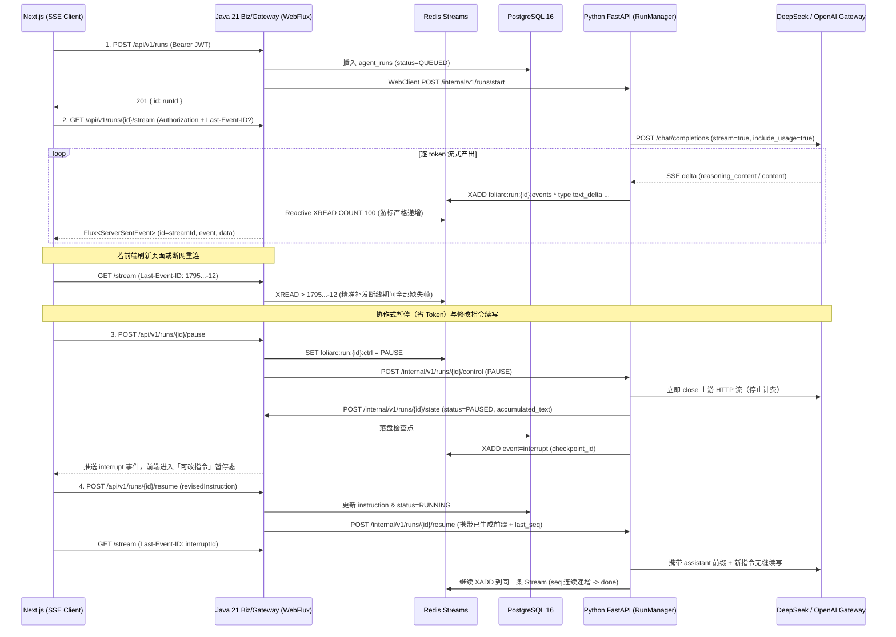

# Phase 1 深度代码导读与面试复盘：企业级 SSE 流式链路与断点续连

本阶段完成了 **Next.js → Java 21 Spring Boot (WebFlux) → Python FastAPI → OpenAI 兼容大模型** 的端到端流式生成链路，攻克了企业 AI 应用最经典的 4 个流式工程难题：

1. **自定义 `fetch` 流式 SSE 客户端**（支持 Bearer 鉴权、401 静默刷新、UTF-8 跨分片解码与粘包/拆包解析）
2. **基于 Redis Streams 的 `Last-Event-ID` 断点续连**（页面 F5 刷新、Wi-Fi 抖动或点击「模拟断线续连」不丢字、不重算）
3. **企业级协作式暂停与续写（Cooperative Pause & Resume）**（真正中止上游 LLM 省 Token + 暂停期间修改指令 + 同流续写）
4. **Spring WebFlux 与 Spring MVC/MyBatis-Plus 共存的响应式网关治理**

---

## 一、全链路时序图



---

## 二、三端核心代码阅读地图（边看代码边准备面试）

### 1. 前端：为什么弃用原生 `EventSource`？
- **核心文件**：`apps/web/src/lib/sse-client.ts` & `apps/web/src/components/ai-copilot-panel.tsx`
- **关键实现点**：
  - 原生 `EventSource` 只支持 `GET` 且不能自定义 `Authorization: Bearer` 请求头。我们改用 `fetch` + `ReadableStream.getReader()` + `TextDecoder("utf-8")`（`{ stream: true }` 防止多字节中文被 TCP 分包切半乱码）。
  - **`SseFrameParser`**：严格按 `\n` / `\r\n` 缓冲拆分，正确处理跨 chunk 换行、多行 `data:` 拼接、注释行 `:` 与 `id:` / `event:` 字段。
  - **高可用重连**：指数退避 + 随机抖动（Exponential Backoff + Jitter）防雪崩、监听 `window` `online/offline` 离线挂起与恢复、35s 心跳看门狗（服务端每 15s 下发 `ping`）。
  - **页面刷新无缝续连**：将 `{ runId, lastEventId, lastSeq, text }` 写入 `sessionStorage`；刷新页面（F5）后自动携带 `Last-Event-ID` 续接，且按 `seq` 去重保证不重复渲染。

#### 流式渲染工程：SSE 蓄水池解耦打字机、零 CLS 防抖动与智能粘底滚动
- **问题背景**：Java 网关的 `RedisStreamSseBridge` 采用 `80ms` 非阻塞批量 `XREAD`，且上游大模型本身也会突发式吐词；若前端直接把每个 chunk 同步写入渲染状态，会出现“卡一下、突然蹦出半行”的顿挫感，同时伴随滚动条弹出折行、状态条换高度等布局抖动。
- **蓄水池解耦模型（`useSmoothTypewriter`，位于 `apps/web/src/components/ai-copilot-panel.tsx`）**：
  - **真实数据层（蓄水池）**：SSE 每收到分片立即追加到 `targetText` 并写入 `sessionStorage` 快照，保证 F5 刷新、断线续连与暂停恢复 **100% 不丢字**。
  - **视觉展示层（水龙头）**：维护已展示长度 `shownLen`，通过浏览器原生 `requestAnimationFrame`（对齐 60Hz 刷新周期）逐帧追赶 `targetText.length`，界面仅渲染 `targetText.slice(0, shownLen)`；严格遵守 React 19 规范（仅在 RAF 回调中更新 `shownLen`，不在 `useEffect` 同步调用 `setState`）。
- **按积压量自适应变速表与零拖尾结束**：

  | 积压字数（`backlog = targetLen - cur`） | 帧调度间隔 | 每步推进字数 | 设计意图 |
  | :--- | ---: | ---: | :--- |
  | `<= 16` | `26ms` | `1` 字 | 保留细腻的逐字打字机颗粒感 |
  | `17 – 60` | `20ms` | `2` 字 | 略微提速，避免滞后感累积 |
  | `61 – 150` | `16ms` | `4` 字 | 应对上游大模型高速吐字 |
  | `151 – 300` | `16ms` | `10` 字 | 平滑消化突发长片段 |
  | `> 300` | `16ms` | `20` 字 | 断线重连批量补帧时快速追平 |

  - 当流式任务结束或进入暂停/审批态（`active === false`）时，直接返回全量 `targetText` 实现零拖尾瞬间对齐。
- **高频状态降频**：仅用于游标续连的 `lastEventIdRef` 与 `lastSeqRef` 改为 Ref 维护（不再每帧触发 `setState`）；`lastHintAgent` 仅在 Agent 阶段切换时才更新 `activeAgent` 与 `statusDetail`。
- **零布局跳动（Zero CLS）与智能粘底滚动**：
  - `statusDetail` 提示条锁定单行高度 `h-8 truncate`，避免 1/2 行折行反复顶动下方输出区；
  - 输出滚动容器固定 `[scrollbar-gutter:stable]` 与 `[overflow-anchor:none]`，预留滚动条轨道以防止首次溢出时横向重排折行；
  - `MULTI_AGENT` 下 `DIRECTOR` 构思大纲直接渲染在主输出区「正在构思本章大纲」打字机卡片中，结束后原地切换为可编辑的「确认本章大纲」卡片，消除折叠区收起引发的整屏跳闪；
  - 监听输出区滚动距底距离：距底 `<= 48px` 时自动贴底跟随；一旦用户向上滚动回看前文，立即停止强拉并在右下角浮现「回到底部 ↓」快捷按钮。

### 2. Java 网关：WebFlux 响应式流代理 + Redis Streams 避坑
- **核心文件**：
  - `services/biz-java/src/main/java/studio/foliarc/biz/run/service/RedisStreamSseBridge.java`
  - `services/biz-java/src/main/java/studio/foliarc/biz/run/service/AgentRunService.java`
  - `services/biz-java/src/main/java/studio/foliarc/biz/run/controller/RunController.java`
  - `services/biz-java/src/main/java/studio/foliarc/biz/config/SecurityConfig.java`
- **3 个企业级面试高频考点**：
  1. **为什么不用 Lettuce `XREAD BLOCK`？**
     Spring Data Redis 的 Lettuce 默认复用单条多路复用连接；若在共享连接上做 `XREAD BLOCK 5000`，会阻塞同连接上的登录刷新等其他 Redis 命令。我们在 `RedisStreamSseBridge` 里改用 **非阻塞 `XREAD COUNT 100`** 配合 Reactor `Mono.delay(80ms)` 异步轮询（有突发积压帧时 0ms 连续排空），同时合并 `Flux.interval(15s)` 心跳并通过 `Sinks.One` 在客户端断开或终态时立即回收定时器。
  2. **为什么 `SecurityConfig` 要加 `.dispatcherTypeMatchers(DispatcherType.ASYNC).permitAll()`？**
     在 Servlet 容器里返回 `Flux<ServerSentEvent>` 会走 Servlet 异步分发（`DispatcherType.ASYNC`）。首次 HTTP `REQUEST` 仍严格走 JWT 鉴权，放行 `ASYNC` 分发可避免异步流完成时被 Spring Security 误拦截。
  3. **代理防缓冲响应头**：`/stream` 显式下发 `Cache-Control: no-cache, no-transform` 与 `X-Accel-Buffering: no`，避免 Nginx / 网关攒包导致前端“憋半天一次性吐出”。

### 3. Python 引擎：真实 OpenAI 兼容流 + 协作式暂停防竞态
- **核心文件**：
  - `services/agent-py/src/foliarc_agent/streaming/llm_client.py`
  - `services/agent-py/src/foliarc_agent/streaming/runner.py`
- **关键设计细节**：
  - **统一 OpenAI 兼容协议**：兼容 DeepSeek（原生解析 `delta.reasoning_content` 思考流与 `prompt_cache_hit_tokens` 缓存命中数）及 OpenRouter / 硅基流动 / 公司内部 AI 聚合中转站。
  - **毫秒级协作式暂停**：用 `asyncio.wait({anext(stream_iter), control_event.wait()}, return_when=FIRST_COMPLETED)` 竞速，一旦收到 `PAUSE`/`CANCEL` 立即 `aclose()` 关闭上游 HTTP 连接止损 Token。
  - **防竞态写顺序（极关键！）**：暂停时**先回调 Java 将 `status=PAUSED` 与 `accumulated_text` 持久化到 PostgreSQL，再往 Redis Stream 写 `interrupt` 事件**——确保前端收到 `interrupt` 瞬间马上点「继续生成」时，数据库状态绝不会滞后。

---

## 三、如何立刻在浏览器里用真实大模型体验 Phase 1

1. 打开仓库根目录的 `.env`（已被 `.gitignore` 忽略，绝不会被提交），填入你的 DeepSeek 或中转站密钥：
   ```dotenv
   LLM_BASE_URL=https://api.deepseek.com/v1
   LLM_API_KEY=sk-你的真实密钥
   LLM_MODEL_WRITER_MAIN=deepseek-chat
   LLM_MODEL_CRITIC_REASONER=deepseek-reasoner
   ```
2. 重启 Python Agent 引擎（读取新 `.env`）：`make dev-py`（或告诉我帮你重启）。
3. 刷新你当前打开的小说工作台页面，在右侧 **「AI 写作助手」** 面板体验 3 个核心场景：
   - **断线续连演示**：点「开始流式生成」，吐字中途直接点 **「模拟断线续连」** 或直接按 **F5 刷新浏览器**，观察右侧自动携带 `Last-Event-ID` 无缝续接不丢字；
   - **暂停改指令续写**：生成一半点 **「暂停」** → 在输入框写一句新转折（如“改为此时天降惊雷，神秘长老现身”）→ 点 **「从断点继续生成」**；
   - **深度思考流**：把模型切换到 **深度推理 (`critic-reasoner`)**，可看到折叠的 `thought_delta` 思考过程流与 Token 缓存命中统计！
