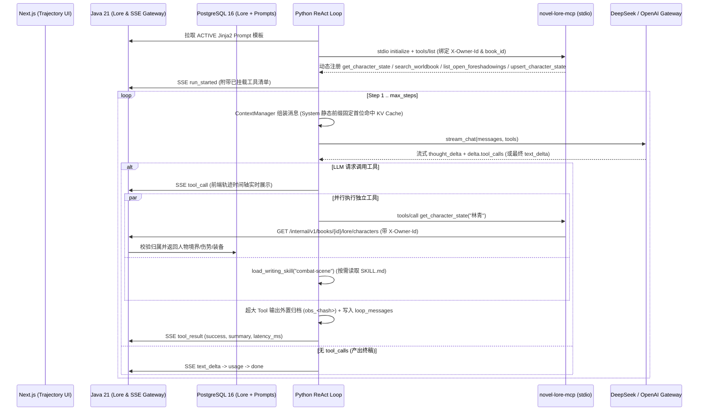

# Phase 2 深度代码导读与面试复盘：手写 Agent Core、MCP 实战与 Context Engineering

本阶段不依赖黑盒 Agent 框架，使用纯 Python 从零手写了完整企业级 Agent 核心引擎，并与 Java 设定库、Next.js 工作台实时打通：

1. **手写 ReAct Agent Loop + 防失控护栏**（流式 `tool_calls` 组装、`max_steps`、Token 预算熔断、重复调用死循环检测）
2. **Pydantic 强类型 Tool 体系 + 错误自愈 + 并行执行**
3. **渐进式披露写作 Skill 系统（Progressive Disclosure）**
4. **自研 `novel-lore-mcp` MCP Server（支持 `stdio` 与 `streamable-http`）+ 真实 MCP Client 动态发现 + 租户权限透传**
5. **Jinja2 Prompt 注册中心 + Context Engineering（Token 预算、滚动摘要压缩、工具大输出外置、KV Cache 前缀固定）**
6. **预留 `SandboxProvider` 抽象协议**（为 Phase 5 硬化 Docker 容器沙箱无缝插拔）

---

## 一、ReAct + MCP + Skill 协同架构

---

## 二、核心代码阅读地图（面试高频追问对应点）

### 1. 手写 ReAct Loop 与防失控三件套
- **代码位置**：`services/agent-py/src/foliarc_agent/agent/loop.py`
- **关键面试亮点**：
  - **流式 `tool_calls` 组装**：在 `llm_client.py` 中逐片解析 `delta.tool_calls`（按 `index` 拼接分片 `id`、`name`、`arguments`），支持单步并行多个工具调用。
  - **死循环检测（`_canonical_signature`）**：对每次 `(tool_name, sorted_json_args)` 做哈希计数；一旦重复调用相同工具+相同参数达到阈值（默认 2 次），立即拦截执行并注入 `LOOP_DETECTED` 纠偏提示，同时在下一轮禁用 `tools` 强制优雅收敛输出正文。
  - **步数上限 + Token 预算熔断**：达到 `max_steps` 或累计消耗达到 `max_token_budget` 时自动进入 `force_final=True` 收尾轮，绝不让 Agent 在失控循环里烧光账单。
  - **兼容 Phase 1 暂停/取消**：每一轮循环及每个流式分片都与 `control_event` 竞速，Agent 模式同样支持随时暂停改指令续写。

### 2. Tool 错误自愈与渐进式 Skill
- **代码位置**：
  - `services/agent-py/src/foliarc_agent/agent/tools.py`
  - `services/agent-py/src/foliarc_agent/agent/skills.py`
  - `services/agent-py/skills/{combat-scene,foreshadowing-craft,ancient-dialogue,plot-unblock}/SKILL.md`
- **关键面试亮点**：
  - **错误自愈（Self-Healing）**：LLM 传出非法 JSON 或不符合 Pydantic Schema 的参数时，不抛异常中断任务，而是返回结构化 `INVALID_JSON_ARGUMENTS` / `VALIDATION_ERROR` 观察结果与修正提示，让模型下一轮自主修复参数。
  - **渐进式披露（Progressive Disclosure）**：4 套中文网文写作 Skill 的完整技法不塞进 System Prompt，而是只在静态前缀注入约 100 Token 的轻量目录，模型仅在需要打斗/伏笔/古风对话/卡文破局时调用 `load_writing_skill` 按需加载。

### 3. 自研 `novel-lore-mcp` 与租户权限透传
- **代码位置**：
  - `services/agent-py/src/foliarc_agent/mcp_server/novel_lore_server.py`
  - `services/agent-py/src/foliarc_agent/agent/mcp_client.py`
  - `services/biz-java/src/main/java/studio/foliarc/biz/lore/controller/InternalLoreController.java`
- **关键面试亮点**：
  - 使用官方 Python `mcp==2.3.0` SDK（`MCPServer`）同时支持 `--transport stdio` 与 `--transport streamable-http`（也可直接注册到任意外部 MCP Host 如 Antigravity / Claude Desktop）。
  - **安全权限边界**：MCP Tool 参数里**故意不暴露 `owner_id` 和 `book_id`**，而是由宿主在启动会话时通过受控环境变量绑定当前登录用户的 `FOLIARC_OWNER_ID` 与 `FOLIARC_BOOK_ID`，向 Java 透传 `X-Internal-Token` + `X-Owner-Id` 做强归属校验，彻底杜绝 Prompt 注入诱导跨租户越权查库。

### 4. Context Engineering（上下文工程）
- **代码位置**：`services/agent-py/src/foliarc_agent/agent/context.py` & `prompts.py`
- **关键面试亮点**：
  - **KV Cache 前缀优化**：`static_system_prompt`（角色规则 + Skill 轻量目录 + 书籍静态档案）严格固定在 `messages[0]` 不变动，所有滚动摘要、工具轨迹与动态指令均追加在尾部，最大化命中 DeepSeek / OpenAI 的 Prompt Caching（可在前端底部看到 `cache=...` 命中数）。
  - **Tool Output Offloading**：单次工具返回超过阈值字符自动归档到 `obs_<hash>`，仅把头尾摘要和引用 ID 放回上下文。
  - **滑动窗口 + 滚动摘要压缩**：历史 ReAct 轮次超出 Token 预算时，自动把较早轮次压缩成结构化摘要，同时确保**不把 `assistant(tool_calls)` 和紧随其后的 `tool` 结果拆散**（避免触发 OpenAI 400 消息序列校验报错）。

---

## 三、如何立刻在浏览器里体验 Phase 2

1. 刷新当前小说工作台页面，点击右侧中间标签 **「设定库」**：
   - 录入一个人物（例如：`林青` / `筑基中期` / `玄铁剑` / `左臂带伤`）和一条伏笔（例如：`残缺玉佩`）；
2. 切回右侧 **「AI 助手」** 标签，确认顶部选中 **「Agent 模式 (MCP+Skill)」**；
3. 输入类似指令：`先查林青的状态与未回收伏笔，按打斗戏规范写一场雨夜交手` → 点击 **「启动 Agent 创作」**；
4. 填好 `.env` 的 `LLM_API_KEY`（重启 `agent-py`）后，就能实时看到右侧时间轴依次亮起 **`MCP get_character_state`**、**`MCP list_open_foreshadowings`**、**`SKILL load_writing_skill`** 的参数与毫秒耗时，随后流式输出严格遵守设定的人物打斗正文！
