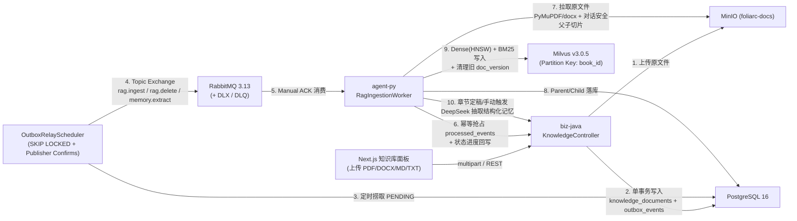

# Phase 3 深度导读：Milvus 企业级混合检索 RAG、PG/Milvus 双写一致与结构化长记忆

> 对应路线图模块 **3.1 ~ 3.5** 与 **4.4**，解决长篇小说创作中传统纯向量 RAG 的四大核心痛点：**专有名词召回难、长篇剧透/时间线错乱、数据库与向量库双写脏数据、仅靠文本片段无法精准追踪人物最新状态与关系网**。

---

## 一、端到端异步数据流架构

---

## 二、核心代码导航

### 1. Java 业务中台与可靠异步事件（`services/biz-java`）
- **V4 数据库迁移**：[V4__create_rag_outbox_and_memory.sql](file:///root/agent-project/foliarc-studio/services/biz-java/src/main/resources/db/migration/V4__create_rag_outbox_and_memory.sql)
  - `knowledge_documents`（含单调递增 `doc_version` 与 `deleted_at` 软删除）
  - `document_chunks`（`PARENT` / `CHILD` 父子文档层级结构）
  - `outbox_events`（本地消息表）+ `processed_events`（消费端幂等去重表）
  - `character_relations`（人物关系三元组）+ `timeline_events`（章节事件时间线）
  - Prompt 注册中心自动平滑升级 `novel_writer_system` 至 **v2**（引导 Agent 调用 `search_knowledge_base` 与 `get_structured_memory`）
- **对象存储**：[MinioStorageService.java](file:///root/agent-project/foliarc-studio/services/biz-java/src/main/java/studio/foliarc/biz/storage/MinioStorageService.java)
- **RabbitMQ 拓扑与 Outbox 中继**：
  - [RabbitMqTopologyConfig.java](file:///root/agent-project/foliarc-studio/services/biz-java/src/main/java/studio/foliarc/biz/outbox/RabbitMqTopologyConfig.java)（声明 Topic Exchange、3 条持久化工作队列、独立 DLX 与 3 条死信队列）
  - [OutboxService.java](file:///root/agent-project/foliarc-studio/services/biz-java/src/main/java/studio/foliarc/biz/outbox/service/OutboxService.java)（与业务表处于同一 `@Transactional` 事务）
  - [OutboxRelayScheduler.java](file:///root/agent-project/foliarc-studio/services/biz-java/src/main/java/studio/foliarc/biz/outbox/service/OutboxRelayScheduler.java)（`FOR UPDATE SKIP LOCKED` 防多实例重复投递 + Publisher Confirms 等 Broker ACK + 指数退避重试）
- **知识库、双写删除与长记忆服务**：
  - [KnowledgeDocumentService.java](file:///root/agent-project/foliarc-studio/services/biz-java/src/main/java/studio/foliarc/biz/rag/service/KnowledgeDocumentService.java)
  - [MemoryService.java](file:///root/agent-project/foliarc-studio/services/biz-java/src/main/java/studio/foliarc/biz/memory/service/MemoryService.java)
  - [ChapterService.java](file:///root/agent-project/foliarc-studio/services/biz-java/src/main/java/studio/foliarc/biz/novel/service/ChapterService.java)（章节切换为 `PUBLISHED` 自动触发索引同步+记忆抽取；删除章节同步清理 Milvus）

### 2. Python Milvus 混合检索与记忆抽取引擎（`services/agent-py`）
- **多格式文档解析**：[parsers.py](file:///root/agent-project/foliarc-studio/services/agent-py/src/foliarc_agent/rag/parsers.py)（PyMuPDF 文本+表格解析、python-docx 标题层级保留、Markdown/小说章节结构切分）
- **小说感知父子切片**：[chunker.py](file:///root/agent-project/foliarc-studio/services/agent-py/src/foliarc_agent/rag/chunker.py)（Parent ~1100 字 + Child ~320 字带重叠；状态机保护中英文引号 `“...”`/`「...」`，绝不在人物对话中间切断）
- **双通道向量与精排**：[embeddings.py](file:///root/agent-project/foliarc-studio/services/agent-py/src/foliarc_agent/rag/embeddings.py)（支持独立配置硅基流动/DashScope/OpenAI `BGE-M3` & `BGE-Reranker`，未配 Key 时自动降级到 1024 维中文 N-gram 特征哈希向量与词法交叉重排，后续填 Key 无需重建 Milvus 集合）
- **Milvus 企业级向量仓储**：[vector_store.py](file:///root/agent-project/foliarc-studio/services/agent-py/src/foliarc_agent/rag/vector_store.py)
  - `VectorStore` 协议抽象 + `MilvusVectorStore` 实现（以及单测专用的 `InMemoryVectorStore`）
  - **`book_id` 作为 Partition Key**（16 分区逻辑多租户隔离）
  - **Dense HNSW (COSINE) + Milvus 原生 BM25 Function（中文分词器 `analyzer_params={"type":"chinese"}`）+ `RRFRanker(k=60)`**
  - **防剧透标量预过滤**：强制 `book_id == X and owner_id == Y and chapter_no <= N`
- **混合检索流水线**：[retriever.py](file:///root/agent-project/foliarc-studio/services/agent-py/src/foliarc_agent/rag/retriever.py)（查询改写/代词消解 → Milvus 混合召回 → Java PG 权威父块还原 Small-to-Big → Rerank 精排）
- **RabbitMQ 消费者 & 记忆抽取**：[worker.py](file:///root/agent-project/foliarc-studio/services/agent-py/src/foliarc_agent/rag/worker.py) · [memory_extractor.py](file:///root/agent-project/foliarc-studio/services/agent-py/src/foliarc_agent/rag/memory_extractor.py)
- **Agent 工具融合**：[tools.py](file:///root/agent-project/foliarc-studio/services/agent-py/src/foliarc_agent/agent/tools.py)（新增 `search_knowledge_base` 与 `get_structured_memory` 两个带自动防剧透上下文的原生工具）

### 3. Next.js 知识库与长记忆面板（`apps/web`）
- [knowledge-memory-panel.tsx](file:///root/agent-project/foliarc-studio/apps/web/src/components/knowledge-memory-panel.tsx)：文档上传与异步进度条、章节一键同步 & 抽记忆、混合检索实测器（防剧透章节上限 + Small-to-Big 父块展开）、人物关系网与事件时间线视图。

---

## 三、高频面试深挖问题与回答要点

1. **PG 和 Milvus 如何保证双写一致性？为什么不直接“先写 PG 再调 Milvus”？**
   - 直接双写存在跨库部分失败和乱序覆盖风险（如先改 v2 又删文档，v1 慢请求晚到反而把已删数据写回 Milvus）。
   - FoliarcStudio 采用 **Transactional Outbox + 单调递增 `doc_version` + 消费端幂等 + 查询侧二次校验** 四重兜底：
     1. 业务表变更与 `outbox_events` 处于同一个 PostgreSQL 本地事务；
     2. `OutboxRelayScheduler` 使用 `FOR UPDATE SKIP LOCKED` + RabbitMQ Publisher Confirms 确保至少投递一次；
     3. Python 消费者先抢占 `processed_events` 幂等键，入库前与入库后校验最新 `doc_version`/软删除态；新版本写完后按 `doc_version < V` 清理旧向量（零检索真空期），删除事件按 `doc_version <= V` 彻底清除；
     4. Small-to-Big 父块还原从 PG 权威表读取并校对 `deleted_at IS NULL AND doc_version = current`，即使异步删除存在百毫秒延迟，也绝不返回已删脏数据。
2. **小说场景为什么不能只用纯稠密向量检索？**
   - 小说充斥大量未登录词和专有名词（人名、法宝名、招式、宗门），纯稠密向量容易把“玄铁重剑”和“青霜长剑”混为一谈；同时单用 BM25 又召回不了语义改写。Milvus 3.0 原生 `Function(FunctionType.BM25)` 配合 `chinese` 分词器 + Dense HNSW + `RRFRanker(k=60)`，再叠加 Small-to-Big 父子索引和 Cross-Encoder Rerank，兼顾专有名词精确命中与长场景上下文完整度。
3. **长篇小说创作的“防剧透”是怎么在向量库实现的？**
   - 上传设定集时默认 `chapter_no = 0`（全局生效），已定稿章节同步时写入真实 `chapter_no`。当作者在写第 `N` 章或修改第 `N` 章时，Milvus 标量预过滤表达式强制附加 `chapter_no <= N`，结构化记忆接口同样过滤 `since_chapter_no <= N` / `chapter_no <= N`，从索引底层杜绝未来章节事件泄露造成时间线崩坏。
