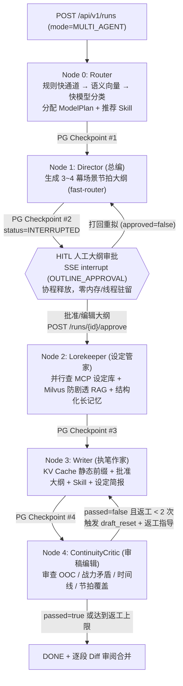

# Phase 4 深度导读：多 Agent 编辑部协作、PostgreSQL Checkpoint HITL 中断恢复与多层路由降级

> 对应路线图模块 **2.7（多 Agent 协作与 HITL）**、**2.8（多层意图路由 + 成本分级模型路由 + 容灾降级链）** 与 **1.6（逐段 Diff 审阅）**。

---

## 一、多 Agent 黑板状态机与 HITL 中断恢复链路

---

## 二、核心代码导航

### 1. PostgreSQL Checkpoint 与 Java HITL 网关（`services/biz-java`）
- [V5__create_multi_agent_checkpoints.sql](file:///root/agent-project/inkflow-studio/services/biz-java/src/main/resources/db/migration/V5__create_multi_agent_checkpoints.sql)：`agent_checkpoints` 黑板检查点表 + `agent_runs` 扩展（`current_node`、`interrupt_type`、`interrupt_payload_json`、`route_intent`、`revision_count`）。
- [RunController.java](file:///root/agent-project/inkflow-studio/services/biz-java/src/main/java/studio/foliarc/biz/run/controller/RunController.java) & [AgentRunService.java](file:///root/agent-project/inkflow-studio/services/biz-java/src/main/java/studio/foliarc/biz/run/service/AgentRunService.java)：
  - `POST /api/v1/runs/{runId}/approve`：接收作者批准/编辑后的大纲或打回意见，恢复 `RUNNING` 并唤醒 Python 引擎从最新 Checkpoint 续跑。
  - `GET /api/v1/runs/{runId}/checkpoints`：查询该次运行的全部 PG 黑板检查点历史。
- [InternalRunController.java](file:///root/agent-project/inkflow-studio/services/biz-java/src/main/java/studio/foliarc/biz/run/controller/InternalRunController.java)：内部检查点写入 `POST /internal/v1/runs/{runId}/checkpoints` 与恢复读取 `GET /internal/v1/runs/{runId}/checkpoint/latest`。

### 2. Python 路由/降级链与五节点编辑部编排器（`services/agent-py`）
- [router.py](file:///root/agent-project/inkflow-studio/services/agent-py/src/foliarc_agent/agent/router.py)：
  - `IntentAndModelRouter`：三层渐进路由（规则快通道 `<1ms` → 1024 维语义向量余弦匹配 → 轻量模型兜底分类）+ 成本分级模型分配（`Director`/`Lorekeeper` 用 `fast-router`，`Writer` 用 `writer-main`，`Critic` 用 `critic-reasoner`）。
  - `FallbackStreamClient`：遇到可重试上游错误（`408/429/5xx/超时`）且尚未输出首字时，沿降级链 `critic-reasoner -> writer-main -> fast-router` 无缝切换并在思考流中上报降级原因。
- [multi_agent.py](file:///root/agent-project/inkflow-studio/services/agent-py/src/foliarc_agent/agent/multi_agent.py)：
  - `EditorialBlackboard`：共享黑板状态模型（避免多 Agent 对话历史滚雪球与传话失真）。
  - `EditorialTeamOrchestrator`：实现 `ROUTER → DIRECTOR → [HITL INTERRUPT] → LOREKEEPER → WRITER ⇄ CRITIC (max_revisions=2)`，每个节点完成后持久化检查点到 PostgreSQL。
- [runner.py](file:///root/agent-project/inkflow-studio/services/agent-py/src/foliarc_agent/streaming/runner.py)：接入 `MULTI_AGENT` 模式、HITL `OUTLINE_APPROVAL` 中断事件落盘（先写 PG 再发 `interrupt` SSE 事件，杜绝审批竞态）。

### 3. Next.js 多 Agent 工作台与 Diff 审阅（`apps/web`）
- [ai-copilot-panel.tsx](file:///root/agent-project/inkflow-studio/apps/web/src/components/ai-copilot-panel.tsx)：
  - 三模式切换（编辑部协同 / 单 Agent / 直连）+ 五节点实时状态条
  - 路由决策卡、审稿评分与返工次数卡、PG Checkpoints 折叠面板
  - 可编辑 **HITL 大纲审批卡片**（支持刷新页面后从 PG 自动恢复待审批大纲）
  - **逐段 Diff 审阅视图**（逐段勾选「采纳/跳过」后一键合并到正文编辑器）

---

## 三、高频面试深挖问题与回答要点

1. **多 Agent 为什么采用 Shared State（黑板模式）+ PostgreSQL Checkpoint，而不是让 Agent 之间直接互相发消息？**
   - 直接对话传递会导致上下文指数膨胀和“传话失真”（Writer 看到大段 Critic 与 Lorekeeper 闲聊），且一旦 HITL 需要等用户思考半小时，内存协程无法长期挂起或跨实例重启恢复。
   - 通过 `EditorialBlackboard` 结构化黑板 + 每节点落库 `agent_checkpoints`，每个角色只读取它需要的结构化字段（如 `outline_text`、`lore_brief`、`critic_guidance`），HITL 中断时彻底释放协程资源，审批后任意节点实例都能从 PG 还原完整状态精确续跑。
2. **Reflection（审稿反思循环）如何避免死循环烧光 Token？**
   - 严格限定 `max_revisions = 2`，`ContinuityCritic` 强制输出结构化 JSON（`passed`/`score`/`issues`/`revision_guidance`），打回时通过 `draft_reset` 通知前端清空旧草稿流，达到上限后优雅收敛输出终稿。
3. **多层意图路由与模型降级链如何兼顾效果、延迟与成本？**
   - 规则快通道处理 80% 明确场景（0 Token、<1ms），语义向量处理泛化描述，仅在置信度边缘才调用轻量模型；结构化大纲与资料汇总下沉到 `fast-router`，核心正文与一致性审计使用主力/推理模型，并由 `FallbackStreamClient` 在 429/5xx 时首字前自动降级，避免单模型抖动拖垮整条流水线。
