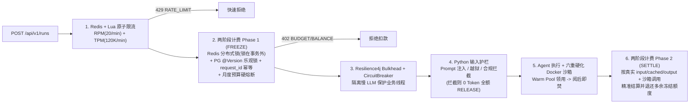

# Phase 5 深度导读：企业级 AI 网关限流熔断、两阶段幂等计费账本、安全护栏与六重硬化 Docker 沙箱

> 对应路线图模块 **2.9（安全护栏）**、**2.10（硬化 Docker 沙箱与红蓝攻防）**、**4.2（Redis+Lua RPM/TPM 限流 + Resilience4j 熔断舱壁）** 与 **4.3（两阶段分布式幂等计费账本）**。

---

## 一、AI 网关防线与两阶段计费全景图

---

## 二、核心代码导航

### 1. Java 企业级网关与分布式计费账本（`services/biz-java`）
- [V6__create_billing_ledger_and_guardrails.sql](file:///root/agent-project/inkflow-studio/services/biz-java/src/main/resources/db/migration/V6__create_billing_ledger_and_guardrails.sql)：整数微积分账户表 `billing_accounts`（含 `CHECK >= 0` 与乐观锁 `version`）、复式幂等流水表 `billing_ledger_entries`（`UNIQUE request_id`）、护栏审计表 `guardrail_audit_logs`。
- [RedisRateLimiterService.java](file:///root/agent-project/inkflow-studio/services/biz-java/src/main/java/studio/foliarc/biz/gateway/RedisRateLimiterService.java)：单条 Lua 脚本原子判定并更新 `RPM` 与 `TPM` 双维配额，避免并发读-改-写竞态。
- [GatewayResilienceConfig.java](file:///root/agent-project/inkflow-studio/services/biz-java/src/main/java/studio/foliarc/biz/gateway/GatewayResilienceConfig.java)：配置 Resilience4j `CircuitBreaker("agentEngine")` 与 `Bulkhead("agentDispatch")`。
- [ModelPricing.java](file:///root/agent-project/inkflow-studio/services/biz-java/src/main/java/studio/foliarc/biz/billing/ModelPricing.java) & [BillingService.java](file:///root/agent-project/inkflow-studio/services/biz-java/src/main/java/studio/foliarc/biz/billing/service/BillingService.java)：
  - 全整数微积分（`1 Credit = 1,000,000 micros`）零浮点误差，精确核算 KV Cache 约 90% 折扣省费；
  - 锁包事务模式：`executeWithAccountLock(userId, () -> txTemplate.execute(...))`，防止锁先于事务提交释放导致脏读；
  - 唯一幂等键 `FREEZE:<runId>`、`SETTLE:<runId>`、`TOPUP:<reqId>`，任意重放绝不重复扣款。
- [BillingController.java](file:///root/agent-project/inkflow-studio/services/biz-java/src/main/java/studio/foliarc/biz/billing/controller/BillingController.java) & [apps/web/src/app/billing/page.tsx](file:///root/agent-project/inkflow-studio/apps/web/src/app/billing/page.tsx)：计费与网关监控看板。

### 2. Python 安全护栏与六重硬化 Docker 沙箱（`services/agent-py`）
- [guardrails.py](file:///root/agent-project/inkflow-studio/services/agent-py/src/foliarc_agent/agent/guardrails.py)：输入端拦截 Prompt 注入、系统提示词套取、DAN 越狱及合规红线；输出端检测密钥/提示词泄露；异步写入 PG 审计表 `guardrail_audit_logs`。
- [sandbox.py](file:///root/agent-project/inkflow-studio/services/agent-py/src/foliarc_agent/agent/sandbox.py)：
  - 通过纯 Python `httpx` Unix Domain Socket 直连 Docker Engine REST API（无需容器内安装 Docker CLI 二进制）；
  - **六重硬化**：`NetworkMode="none"`（禁外网/SSRF）、`ReadonlyRootfs=True` + 32MB `noexec,nosuid` `/tmp`、`CapDrop=["ALL"]` + `no-new-privileges:true` + `65534:65534` 非 root、`128MiB` 内存禁 swap + `0.5` CPU + `PidsLimit=32` 防 Fork Bomb、零宿主机密钥透传、超时强杀；
  - **Warm Pool + 阅后即焚 + Reaper**：预热池降冷启动延迟，每次执行完毕无论成败立刻 `DELETE ?force=true&v=true` 绝不跨租户复用，后台 Reaper 定时清理超时僵尸容器；配置 `SANDBOX_DOCKER_RUNTIME=runsc` 即可零代码切 gVisor。
- [test_phase5_guardrails_and_sandbox.py](file:///root/agent-project/inkflow-studio/services/agent-py/tests/test_phase5_guardrails_and_sandbox.py)：自动化红蓝攻防安全测试集（正常小说分析脚本 + SSRF 外泄 + 读密钥 + 篡改根文件系统 + 非 root/零 Cap 校验 + Fork Bomb + 死循环超时强杀 + 零僵尸残留验证）。

---

## 三、高频面试深挖问题与回答要点

1. **分布式扣费为什么把 Redis 分布式锁放在数据库事务的外层？**
   - 若锁在 `@Transactional` 内部释放，锁释放瞬间事务尚未 `COMMIT`，下一个并发请求抢锁后会读到旧余额造成超扣。FoliarcStudio 用 `executeWithAccountLock(..., () -> txTemplate.execute(...))` 确保事务提交后才用 Lua 原子校验 token 释放锁，同时数据库层叠加 MyBatis-Plus `@Version` 乐观锁与 `CHECK (balance_micros >= 0)` 兜底。
2. **为什么 AI 计费不能直接“用完再扣”，也不能只做“事前一次性扣费”？**
   - 用完再扣会被并发请求打穿余额（透支）；事前一口价无法反映实际输出长度与 KV Cache 命中率。两阶段 `FREEZE → SETTLE` 在调用前预扣最大估算并卡住月度预算，结束后按真实 `input / cached / output` 与沙箱次数精准结算、退还多余冻结额度，并通过 `SETTLE:<runId>` 唯一约束保证回调重放完全幂等。
3. **Agent 执行 Python 脚本为什么要做六重硬化和“阅后即焚”，不能直接在 FastAPI 容器里 `exec()` 或复用同一个容器？**
   - 宿主机/同进程 `exec()` 一行 `os.environ` 就能偷走 `LLM_API_KEY`、`JWT_SECRET` 和数据库密码，甚至内网探测 Redis/Milvus；跨租户复用容器则存在 `/tmp` 残留与侧信道泄露。预热池仅预热空白镜像容器，领用执行完毕立即强删，兼顾 ~100ms 延迟与企业级租户隔离。
