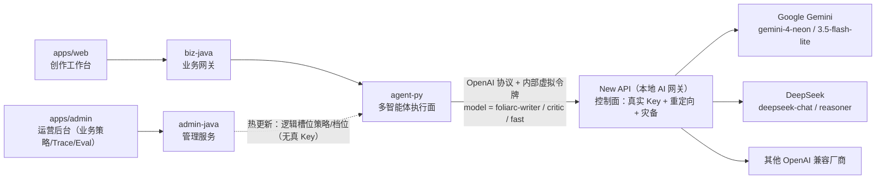

# Phase 7C · 企业级 AI 网关与逻辑能力槽位解耦方案

> **目标**：建立清晰的「控制面（AI 网关） / 执行面（Agent Runtime） / 业务面（Admin 后台）」三层边界，使 FoliarcStudio 彻底告别在业务代码或 `.env` 中硬编码上游厂商型号与密钥，实现**零重启热切换模型、多 Key 轮询与跨厂商容灾**，同时避免因网关模型重定向导致思考模型预算截断或参数不兼容。

---

## 1. 架构分层与职责边界（企业级标准）



| 层面 | 负责组件 | 核心职责 | 严禁越界事项 |
| :--- | :--- | :--- | :--- |
| **控制面（AI 网关）** | `foliarc-new-api` (`:3002`, 内网 `http://new-api:3000/v1`) | 保管上游真实 API Key、渠道测速、多 Key 轮询、限流、失败自动 Fallback、**逻辑名 → 物理模型重定向（Model Mapping）**、底层请求与 Token 消耗日志 | 不耦合小说业务规则、Prompt 模板或会员权益 |
| **执行面（Agent Runtime）** | `services/agent-py` | 只面向 **3 个逻辑能力槽位** 发请求；按槽位显式声明思考模式、推理深度（`reasoning_effort`）、`max_tokens` 放大上限与 `json_object` 能力；不再依赖物理模型名字符串猜测 | 不硬编码具体厂商型号，不存第三方真实 Key |
| **业务面（运营后台）** | `apps/admin` + `admin-java` | 管理 Prompt 版本、Eval 评测、Trace 观测、用户额度与 VIP 权益；配置**业务级槽位策略**（如各槽位思考档位、最大输出、超时、VIP 档位映射）；提供跳转到 AI 网关后台的快捷入口 | **绝不存储、回显或代理上游厂商真实 API Key**，不重复造渠道代理轮子 |

---

## 2. 核心痛点：为什么不能直接把模型名全改成别名就完事？

在当前 [llm_client.py](../services/agent-py/src/foliarc_agent/streaming/llm_client.py) 中，客户端是通过模型名称字符串（如包含 `gemini-4`、`reasoner`、`deepseek-r1`）来推断三件事的：
1. **是否需要放大 `max_tokens`**：思考模型（Gemini 3/4、DeepSeek R1 等）的思考链 Token 与最终正文共享 `max_tokens`，不放大极易截断。
2. **是否应移除 `temperature`**：Gemini 3.6+/4、OpenAI o 系列及部分推理模型不推荐或拒绝传 `temperature`。
3. **是否支持 `response_format={"type": "json_object"}`**：Gemini 4 思考模型原生支持与思考模式共存，而部分旧推理模型不支持。

一旦在 New API 里采用逻辑别名（例如 `agent-py` 发出 `model="foliarc-writer"`，New API 重定向为 `gemini-4-neon`），`agent-py` 看到的字符串只有 `"foliarc-writer"`，**字符串匹配会全部失效**。

---

## 3. 技术方案：逻辑能力槽位 + 显式能力档案（Slot Capability Profile）

### 3.1 三个标准逻辑能力槽位

| 内部 Alias | 建议逻辑模型名（发给 New API） | 典型职责 | 默认建议映射（在 New API 中配置） |
| :--- | :--- | :--- | :--- |
| `writer-main` | `foliarc-writer` | 主力正文续写、润色、跨章修订 | `gemini-4-neon`（或 `gemini-4-hydrogen` / `deepseek-chat`） |
| `critic-reasoner` | `foliarc-critic` | 连贯性审校、伏笔核验、结构化 JSON 诊断 | `gemini-4-neon`（或 `gemini-4-argon` / `deepseek-reasoner`） |
| `fast-router` | `foliarc-fast` | 意图路由、章节大纲草拟、L2 摘要蒸馏、实体抽取 | `gemini-3.5-flash-lite`（或 `gemini-4-neon` + `low` 档） |

> **向后兼容**：如果 `.env` 中仍直接填物理模型名（如 `gemini-4-neon`、`deepseek-chat`），系统保持 100% 兼容，行为与当前一致。

### 3.2 显式槽位能力配置（彻底解耦字符串猜测）

在 `services/agent-py/src/foliarc_agent/config.py` 中新增按槽位可覆盖的能力配置（均默认为 `auto` 或空字符串，零侵入现有配置）：

```env
# 逻辑模型名（推荐）或直接填物理模型名（向后兼容）
LLM_MODEL_WRITER_MAIN=foliarc-writer
LLM_MODEL_CRITIC_REASONER=foliarc-critic
LLM_MODEL_FAST_ROUTER=foliarc-fast

# 全局默认推理深度（可被单槽位覆盖）："" | minimal | low | medium | high | xhigh
LLM_REASONING_EFFORT=high

# --- 可选：按槽位显式能力档案（使用逻辑名重定向时推荐配置） ---
# thinking_mode: auto（按模型名识别）| on（启用思考预算放大并跳过 temperature）| off（普通非思考模型）
LLM_SLOT_WRITER_THINKING=auto
LLM_SLOT_CRITIC_THINKING=auto
LLM_SLOT_FAST_THINKING=auto

# 单槽位推理深度覆盖（留空则沿用全局策略；fast 槽位默认限制在 low 以保证响应速度）
LLM_SLOT_WRITER_EFFORT=
LLM_SLOT_CRITIC_EFFORT=
LLM_SLOT_FAST_EFFORT=

# 单槽位 JSON Mode 支持：auto | true | false（Gemini 4 设为 true，DeepSeek-R1 设为 false）
LLM_SLOT_CRITIC_JSON_MODE=auto

# 单槽位输出上限天花板（默认：思考槽位 32768 / 普通槽位 8192）
LLM_SLOT_MAX_OUTPUT_CEILING=32768
```

### 3.3 `llm_client.py` 决策矩阵

引入数据类 `SlotCapabilities`（`thinking: bool`, `reasoning_effort: str | None`, `allow_temperature: bool`, `allow_json_mode: bool`, `max_tokens_ceiling: int`），由 `resolve_slot_capabilities(settings, model_name, model_alias)` 统一计算：

1. **`thinking` 判定**：
   - `explicit == "on"` → `True`
   - `explicit == "off"` → `False`
   - `explicit == "auto"` → 沿用 `is_reasoning_model(model_name, model_alias)` 或 `bool(slot_effort)`
2. **`reasoning_effort` 判定**：
   - 优先使用该槽位显式 `LLM_SLOT_<SLOT>_EFFORT`；
   - 其次使用全局 `LLM_REASONING_EFFORT`（对 `fast-router` 默认在 `high/xhigh` 时收敛为 `low`，除非 `LLM_SLOT_FAST_EFFORT` 显式指定了 `high`）。
3. **`allow_temperature` 判定**：
   - `not thinking` 时传 `temperature`；`thinking=True` 时省略 `temperature`（满足 Gemini 3.6+/4 与 o 系列规范）。
4. **`allow_json_mode` 判定**：
   - 显式 `true` / `false` 优先；
   - `auto` 时：非思考模型或 `is_gemini_thinking_model(model_name)` 返回 `True`；DeepSeek Reasoner 等不支持 `json_object` 的推理模型返回 `False`。
5. **`effective_max_tokens` 放大规则**：
   - `thinking=True`：`min(ceiling, max(requested + 12288, requested * 4, 16384))`（确保 `high` 档长思考不会截断正文或审校 JSON）；
   - `thinking=False`：保持 `requested`。

---

## 4. New API 网关侧标准配置规范

### 4.1 渠道「模型重定向（Model Mapping）」配置示例

在 New API 后台 **渠道 → 编辑 Gemini 渠道** 中：
1. **模型列表**填入逻辑名：`foliarc-writer`、`foliarc-critic`、`foliarc-fast`（也可同时保留原始物理名方便调试）。
2. **模型重定向（JSON）**填入：
   ```json
   {
     "foliarc-writer": "gemini-4-neon",
     "foliarc-critic": "gemini-4-neon",
     "foliarc-fast": "gemini-3.5-flash-lite"
   }
   ```
3. **跨厂商容灾示例**：再建一个权重/优先级更低的 DeepSeek 渠道，模型同样填 `foliarc-writer`、`foliarc-critic`、`foliarc-fast`，模型重定向填：
   ```json
   {
     "foliarc-writer": "deepseek-chat",
     "foliarc-critic": "deepseek-reasoner",
     "foliarc-fast": "deepseek-chat"
   }
   ```
   当主渠道 Gemini 遇到 429 限流或网络抖动时，New API 自动切到备用渠道，**FoliarcStudio 业务代码零感知、零重启**。

### 4.2 虚拟令牌最小权限原则

在 New API **API 密钥** 中为 FoliarcStudio 签发专用令牌（如 `foliarc-studio`）：
- 模型白名单仅勾选：`foliarc-writer`、`foliarc-critic`、`foliarc-fast`（或当前调试使用的物理名）。
- 启用独立额度统计，便于在 New API **使用日志** 中按项目核算真实 API 账单。

---

## 5. 分阶段实施路线

### Phase 7C-1 · 执行面逻辑槽位能力档案（低风险、高收益）
- **改动范围**：
  - `services/agent-py/src/foliarc_agent/config.py`：新增按槽位能力配置字段（全部带 `auto` 默认值）。
  - `services/agent-py/src/foliarc_agent/streaming/llm_client.py`：抽象 `SlotCapabilities` 与 `resolve_slot_capabilities()`，统一驱动 `max_tokens`、`temperature`、`reasoning_effort`、`response_format`。
  - `services/agent-py/tests/test_phase4_multi_agent.py`：补充逻辑别名（`foliarc-writer` / `foliarc-critic` / `foliarc-fast`）搭配显式能力档案的回归测试，确保与物理模型名模式 100% 兼容。
  - `.env.example`：补充企业级逻辑槽位配置示例与注释。
- **验收标准**：
  - `ruff check` 与 `pytest` 全绿；
  - 无论 `.env` 填 `gemini-4-neon` 还是 `foliarc-writer`（配合 New API 模型重定向），`agent-py` 均稳定输出、无截断、无参数报错。

### Phase 7C-2 · Admin 运营后台业务策略联动（可选后续迭代）
- **改动范围**：
  - `services/java/admin-java` + `apps/admin`：
    - 新增「AI 模型策略」只读运行态卡片（展示当前激活的逻辑槽位、思考档位、New API 连通状态，**不展示任何 Key**）+ 一键跳转 New API 管理后台链接；
    - 支持管理员在 `apps/admin` 动态调整业务级策略（各槽位 `reasoning_effort` 档位、VIP/普通用户路由策略），写入 Redis/Postgres 后 `agent-py` 热加载生效。

---

## 6. 安全与运维检查清单

- [x] `new-api` 默认仅监听 `127.0.0.1:${NEW_API_PORT:-3002}:3000`，避免暴露公网。
- [x] 独立 256-bit 随机 `NEW_API_SESSION_SECRET` 与 `NEW_API_CRYPTO_SECRET`。
- [x] 启用 `no-new-privileges:true`、`mem_limit: 512m` 与独立持久化卷 `new_api_data`。
- [x] New API 后台 **身份验证** 中关闭公开注册，仅保留管理员账号。
- [ ] （生产上线前）将初始化时使用的简单本地密码更新为强密码，并在 New API 令牌中配置最小模型白名单。
