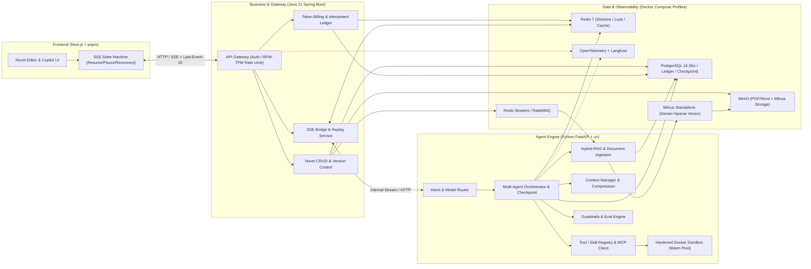
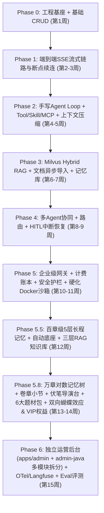

# FoliarcStudio（卷弧工坊）：企业级小说创作 Agent 平台实战路线图与学习清单

> **定位**：面向求职与全栈进阶的企业级 AI Agent 项目，采用 **Next.js（前端/交互层） + Java 21 Spring Boot（业务与网关计费层） + Python FastAPI（Agent 与 RAG 引擎层）** 三端解耦 Monorepo 架构，关系型数据使用 **PostgreSQL**，向量检索独立采用企业级 **Milvus**。
>
> **为什么选“长篇小说 Agent”作为求职项目？**
> 面试官已经看腻了“套壳 ChatGPT”和“简单知识库问答”。长篇小说创作天然倒逼你解决工业界最硬核的 Agent 难题：**超长上下文一致性（防吃书/人设崩塌）、长耗时流式任务的断点续连与人工介入（HITL）、多 Agent 分工评审、PG + Milvus 双写一致的混合检索、硬化容器沙箱执行、高并发 Token 预扣与精准结算**。

---

## 一、已定稿项目配置与技术栈

| 维度 | 最终选型 | 说明 |
| :--- | :--- | :--- |
| **项目名 & 仓库** | **FoliarcStudio** (`~/agent-project/foliarc-studio`) | 单仓 Monorepo（按目录路径独立触发 CI） |
| **前端** | **Next.js (App Router + TS)** + `pnpm` (`fnm`) + Tailwind CSS + `shadcn/ui` | 富文本编辑（Tiptap）、Diff 审阅、自研 SSE 状态机 |
| **业务与网关** | **Java 21 + Spring Boot 4.1 + MyBatis-Plus + Maven (`./mvnw`)** | 虚拟线程、MyBatis-Plus `@Version` 乐观锁、统一 AI 网关、RPM/TPM 限流、幂等计费账本 |
| **Agent 引擎** | **Python 3.12 + FastAPI + `uv`** | 手写 Agent Loop / Tool / Skill / MCP / 上下文压缩 / Hybrid RAG / 硬化 Docker 沙箱 |
| **模型接入** | **统一 OpenAI 兼容网关 + 模型别名路由** | 主力 DeepSeek + Gemini Flash / 聚合网关（含 Embedding & Rerank） |
| **数据存储** | **PostgreSQL 16** + **Milvus Standalone** + **Redis 7** + **MinIO** | PG 管强事务与状态；Milvus 专攻混合向量检索（复用 MinIO） |
| **本地基础设施** | **WSL 复用 Windows Docker Desktop + Compose `profiles`** | `core`(PG+Redis) / `rag`(MinIO+etcd+Milvus) / `obs`(Langfuse) 按需启停 |
| **代码/工具沙箱** | **`SandboxProvider` 抽象 + 硬化 Docker 容器沙箱** | 六重安全硬化 + 预热池 + 僵尸回收；配置化预留 gVisor (`runsc`) / E2B 扩展 |

---

## 二、企业级三层系统架构总览

明确 **Java 与 Python 的职责边界** 与 **PG 与 Milvus 的存算分离** 是面试必考题：
- **Next.js**：负责富文本写作体验、流式协议解析、Diff 审阅、前端容错状态机。
- **Java Spring Boot**：发挥高并发与强事务优势，负责认证鉴权、多租户权限、小说/章节版本管理、**统一 AI 网关（限流/熔断）**、**分布式计费账本**、异步任务编排与流式桥接。
- **Python FastAPI**：发挥 AI 生态优势，专注 **Agent Loop、Tool/Skill/MCP、上下文压缩、Hybrid RAG（Milvus）、文档解析、硬化 Docker 沙箱、多 Agent 编排与评测护栏**。

---

## 三、全栈技能与功能实现清单（可逐项打勾）

> [!TIP]
> 标有 `★` 的是**企业级面试高频追问的核心加分项**。

### 模块 1：前端交互与流式工程（Next.js + TypeScript）

- [x] **1.1 自定义 SSE 客户端（弃用原生 `EventSource`）**
  - 使用 `fetch` + `ReadableStream` + `TextDecoder` 实现支持 `POST`、`Authorization` Header 和自定义协议的 SSE 解析器（处理 TCP 拆包/粘包、跨 chunk 换行拼接）。
- [x] **1.2 结构化流式事件协议（Structured Stream Protocol）** `★`
  - 统一事件类型：`run_started`、`thought_delta`（思考过程）、`tool_call`、`tool_result`、`text_delta`（正文流）、`interrupt`（等待人工确认）、`usage`（Token 消耗）、`error`、`done`。
- [x] **1.3 SSE 断点续连（Resumable Stream）**
  - 前端持久化当前 `run_id` 与最后收到的 `last_event_id`；页面刷新、切网或断线后携带 `Last-Event-ID` 请求后端，从 Redis Streams 补发缺失分片，无缝衔接不丢字、不重复生成。
- [x] **1.4 自动重连与心跳检测**
  - 指数退避 + 随机抖动（Exponential Backoff + Jitter）重连策略、最大重试上限、服务端 `ping` 心跳超时检测、浏览器 `online/offline` 事件感知。
- [x] **1.5 暂停、继续与取消（Pause / Resume / Cancel）**
  - **前端取消**：`AbortController` 断开连接并发送 `POST /runs/{run_id}/cancel`。
  - **后端协作式暂停与恢复**：前端发送 `pause`，Agent 在安全检查点挂起并保存状态；用户修改指令或直接点 `resume` 后从检查点继续流式输出。
- [x] **1.6 小说编辑器与 AI 协作体验** `★`
  - 写作台集成划词协作工具条（支持 **AI 划词改写 / 划词扩写** 及文风锚点一键收藏）、AI 生成内容 **Git 式逐段 Diff 审阅弹窗（LCS 段落比对、逐 Hunk Accept/Reject、合并预览与局部选段精确回填）**、防抖自动保存与乐观锁版本冲突提示。
- [x] **1.7 前后台解耦与创作工作台体验** `★`
  - **前台（`apps/web :3000`，作者端）**：极简三栏写作台（章节目录 + 正文编辑 + 「AI 写作 / 故事设定」双栏 + 按需抽屉「历史版本」），完全隐藏计费、RAG/Milvus、Checkpoint 等工程概念；支持极简「我的资料库」上传个人参考文档与按书启用开关。
  - **独立运营后台（`apps/admin :3001` + `admin-java :8081`，详见 [`06-ADMIN-SYSTEM-SEPARATION.md`](./architecture/06-ADMIN-SYSTEM-SEPARATION.md)）**：前后端物理独立拆分，仅内网部署与独立 `aud=foliarc-admin` 管理员鉴权，统一承载公共/定向 RAG 资料库、异步任务中心、Agent 会话执行日志时间轴、计费/VIP 权益配置与 Prompt 模板管理。

---

### 模块 2：Agent 核心引擎（Python + FastAPI）

> [!IMPORTANT]
> **学习策略**：核心机制（Agent Loop、Tool Calling、上下文压缩、状态机）**务必先用纯 Python + OpenAI 兼容 SDK 手写一遍**，彻底吃透底层后再引入或对比 LangGraph 等框架，这样面试被问底层原理时才能对答如流。

- [x] **2.1 Agent Loop（从零手写执行循环）**
  - 实现 ReAct 循环（Thought -> Action -> Observation -> Final Answer）与 Plan-and-Execute 模式。
  - **防失控机制** `★`：最大步数限制（`max_steps`）、Token 预算熔断、死循环检测（连续调用相同 Tool + 相同参数时强制干预）、优雅降级输出。
- [x] **2.2 Tool 体系（工具注册与健壮执行）**
  - Pydantic 强类型定义 Tool Schema，支持并行 Tool Calls、超时控制、自动重试、幂等键。
  - **工具错误自愈** `★`：参数校验失败或执行报错时，返回结构化错误提示让 LLM 自我修正而非直接崩溃。
  - 小说专属工具示例：`get_character_state`、`update_foreshadowing`、`search_worldbook`、`read_prev_chapter_summary`、`check_timeline_conflict`、`run_analysis_script`（走沙箱）。
- [x] **2.3 Skill 系统（模块化写作技能包）**
  - 设计**渐进式披露（Progressive Disclosure）**机制：System Prompt 仅放轻量 Skill 目录（名称+触发场景），Agent 按需加载完整 Skill 规范、示例及受控 `scripts/`（例如：`打斗场景描写 Skill`、`悬疑伏笔埋设 Skill`、`古风对话润色 Skill`、`卡文破局 Skill`、`全书节奏统计 Skill`），节省大量上下文 Token。
- [x] **2.4 MCP（Model Context Protocol）实战**
  - 实现 **MCP Client/Host** 接入 Agent Runtime，动态发现工具（`tools/list`）与资源（`resources/read`）。
  - 手写 1~2 个专属 **MCP Server**（如 `novel-lore-mcp` 暴露人物/世界观库，支持 `stdio` 和 `Streamable HTTP` 两种传输协议），并在服务端实现租户/用户权限透传。
- [x] **2.5 Prompt 编排与版本管理**
  - 基于 Jinja2 的模板化 Prompt 组合（角色设定 + 写作禁忌 + 风格样本 + 动态记忆 + 结构化输出约束）。
  - **Prompt 注册中心** `★`：支持版本号、灰度/A-B 测试、回滚（存数据库而非写死在代码里）。
- [x] **2.6 上下文管理与压缩（Context Engineering）**
  - **Token 预算分配器**：精确计算（`tiktoken`）各区域配额（System + Skill + 长期记忆 + RAG 片段 + 近期对话 + 输出预留）。
  - **分层压缩策略**：滑动窗口 + 滚动摘要（Rolling Summary）+ 大工具输出截断与外置（Tool Output Offloading，只给摘要和引用 ID）。
  - **KV Cache 前缀优化（Prompt Caching）** `★`：将静态 System Prompt、固定世界观设定放在前缀最前面，动态指令放尾部，显著降低 TTFT 延迟与 50%~80% 的输入成本。
- [x] **2.6.1 百章级 5 层长程记忆与零配置自动底座（Phase 5.5）** `★`
  - **零配置自动涌现式 L0 静态底座**：作者未手填简介/世界观时，冷启动可直接开写第 1 章；在写完第 1 章、第 3 章及每满 10 章（每卷）时，后台异步归纳 `auto_inferred` 故事宪章（主线梗概、人称视角、文风基调、核心人物与规则），低频刷新以保住 KV Cache 命中率；严格遵守 `author_defined > auto_inferred`，作者随时可一键确认/编辑并锁定，AI 永不覆盖作者手填内容。
  - **5 层定额上下文金字塔（单次输入恒定 8k~12k Tokens）**：
    - `L0 静态底座`（~1k，KV Cache 前缀）+ `L1 热窗口`（当前章 + 上一章末尾 1500~2500 字原文，~2.5k）+ `L2 滚动摘要`（近期 5~10 章结构化单章摘要 `chapter_summaries` + 更早章节每 10~20 章归并卷级摘要 `volume_summaries`，~2.5k）+ `L3 实体感知动态账本`（仅注入当前章/上章提及的活跃角色状态 + `OPEN` 未回收伏笔，~1.5k）+ `L4 按需召回 RAG`（打捞百章前原场景父块，~2.5k）。
  - **修改前文的级联脏标记（Cascade Invalidation）**：`chapters` 维护 `content_hash` / `summary_dirty`，作者回头修改历史章节后自动触发异步重算：单章摘要 → 所属卷摘要 → Milvus 切片 → 结构化记忆。
- [x] **2.6.2A 万章级三级柔性结构、4 层对数记忆树与 Coarse-to-Fine 检索（Phase 5.8A，已完成）** `★`
  - **三级柔性文学结构（Volume → Chapter → Section）**：支持网文隐式单节无感写作与古典/严肃文学大章制（单节上限 10 万字联动 VIP 配额、单章聚合 20 万字，超 1.2 万字自动 Map-Reduce 并行压缩）；全链路切换为单调叙事刻度 `narrative_order = chapter_no * 1000 + section_no`。
  - **万章级 O(1) 4 层对数摘要树 + 统一编译**：`story_rollup_summaries`（Tier 1 卷 / Tier 2 篇 / Tier 3 纪元）+ 三档自适应精度（`PRECISE`/`EXPEDITION`/`EPIC`）+ 反向预算装配（≤ 4,100 字绝不截断近期章节）+ `ChapterDistiller` 单次统一编译 + Milvus `chunks_v2` / `summary_vectors` Coarse-to-Fine 两阶段万章检索 + 前端卷/章/小节柔性目录树与整章预览。
- [x] **2.6.2B 伏笔全生命周期导演台与连续性防线（Phase 5.8B，已完成）** `★`
  - **6 态伏笔状态机与防提前剧透双层隔离**：支持 `PLANNED / PLANTED / HINTED / TRIGGERED / RESOLVED / DORMANT_CLUE / ABANDONED` 状态流转与 `#F01` 编号；`surface_clue` 与 `hidden_truth` 物理隔离，Writer 仅见表象与导演指令，Critic 持有潜伏底牌清单与 `PAYOFF` 埋设原文锚点（精准回捞当年原文）。
  - **人物与事实连续性防线**：人物别名归一（Alias）、冷热休眠与一键唤醒（`CORE_PINNED / ACTIVE / DORMANT / DEAD`）、字段锁定防 AI 覆盖（`locked_fields`）、按节状态快照时间旅行（`character_state_snapshots`）、源小节归属回滚（`source_section_id`）、POV 视角信息隔离（`known_by`）以及高危变更审批闸门（`memory_proposals`）。
- [x] **2.6.2C 6 大题材档案包、分层 Skill 路由与少样本黄金文风锚点（Phase 5.8C，已完成）** `★`
  - **两级题材分类体系与 6 处全链路联动**：内置 6 大标准主分类（仙侠/恐怖/古典/悬疑/科幻/都市）+ 自由副标签（支持“古典 + 民俗恐怖”跨界叠加）；升级 11 个分层写作技能包（`genres`/`sub_tags` 过滤路由），消除跨题材误触发；人物扩展属性收口至 `characters.custom_attributes JSONB`（前端按题材动态渲染表单、仙侠 `realm` 双向兼容）；`Director` 节拍骨架、`Writer` 反 AI 味禁忌词与 `Critic` 差异化审稿 Rubric 全链路按题材自适应；公共 RAG 资料库升级 `genre_codes` + `genre_tags` 标准化匹配。
  - **少样本黄金文风锚点（Style Anchors）**：新增 `style_anchors` 表与增删启停接口（联动 VIP `maxStyleAnchors` 配额与总字数 ≤ 900 字硬上限），固定注入 L0 静态 System Prefix 100% 复用 KV Cache，支持编辑器划词一键收藏为本书文风参考，根治长篇续写“AI 味自噬”。
- [x] **2.6.2D 双向自选范围蝴蝶效应引擎（Phase 5.8D，已完成，详见 [`docs/architecture/04-RIPPLE-EDIT-ENGINE.md`](./architecture/04-RIPPLE-EDIT-ENGINE.md)）** `★`
  - 原生对接 Phase 5.5 已落地的 VIP 动态权益中台与分布式计费账本，支持 5 种自由范围模式（`BIDIRECTIONAL / FORWARD / BACKWARD / CUSTOM_RANGE(按章/按卷) / FULL_BOOK`），并严格执行 VIP 跨度、日扫次数与单批补丁上限以及 `BLAST_RADIUS_EXCEEDED` 爆炸半径熔断。
  - 全闭环四阶段流水线：`Stage 1 Fact Diff`（过滤纯错别字/润色，提取原子事实变更）→ `Stage 2 Impact Radar`（PG 别名索引 + Milvus 区间/Coarse-to-Fine 混合粗筛 + 区分 `BACKWARD` 前文铺垫矛盾与 `FORWARD` 后文剧情穿帮）→ `Stage 3 Sparse Surgical Patch`（分批预冻结 + 段落级逐字锚定局部补丁）→ `Stage 4 人工逐章 Diff 审阅采纳`（乐观锁防并发覆盖 + 自动打快照 + 仅对采纳节定向重算记忆与索引）。
- [x] **2.7 多 Agent 架构与协作编排**
  - 设计“小说编辑部”多 Agent 团队：
    - `Director（总编/规划师）`：拆解章节大纲与场景节拍（Beat Sheet）。
    - `Lorekeeper（设定管家）`：检索世界观、人物状态与未回收伏笔。
    - `Writer（执笔作家）`：按指定文风与 Skill 撰写正文。
    - `ContinuityCritic（审稿/查重编辑）`：检查人设 OOC、时间线矛盾、战力崩坏，不通过则打回重写（Reflection 循环，限制最大打回次数如 2 次）。
  - **状态共享模式**：基于 Shared State（黑板模式）+ PostgreSQL Checkpoint 持久化，避免 Agent 间“传话失真”。
  - **HITL（Human-in-the-Loop）中断与恢复** `★`：如 `Director` 生成章节大纲后主动触发 `interrupt`，等待前端用户修改/批准后再唤醒 `Writer` 写正文。
- [x] **2.8 Agent 路由与模型调度（Routing & Fallback）**
  - **多层意图路由**：规则/关键词快速通道 -> Embedding 语义路由 -> 轻量小模型分类 -> LLM 决策。
  - **智能模型路由（Model Routing）** `★`：简单任务（摘要提取、意图分类、实体抽取）路由至廉价快模型；核心任务（高潮剧情创作、逻辑审稿）路由至旗舰模型。
  - **容灾降级（Fallback Chain）**：主模型 429 限流或 5xx 超时时自动无缝切换备用模型/厂商。
- [x] **2.9 Agent 准确性与安全护栏（Guardrails）**
  - **输入护栏**：Prompt 注入检测（防套取系统 Prompt）、越狱拦截、敏感词/内容合规审核（国内网文合规刚需）。
  - **输出护栏**：结构化 Schema 校验、**小说一致性核验**（对比人物当前状态与时间线防止幻觉/吃书）。
  - **高危工具审批**：批量修改世界观或覆盖已发布章节等写操作必须经过用户确认。
- [x] **2.10 Agent 代码与工具执行沙箱（Hardened Docker Sandbox）** `★`
  - **业务落地场景**：小说角色出场/节奏/情绪曲线 Python 分析、战力/资产/时间线数值精确校验、Skill 附带脚本及 EPUB/PDF 成品导出、不可信文档解析隔离。
  - **抽象与实现**：定义 `SandboxProvider` 统一接口，亲手实现 **`DockerSandboxProvider`**，配置化预留 **gVisor (`runsc`)** 与 **E2B / Firecracker MicroVM** 扩展口。
  - **六重安全硬化**：`--network=none`（防 SSRF 与外泄）、`--read-only` + 限额 `tmpfs` `/tmp`、`--cap-drop=ALL` + `no-new-privileges` + 非 root 用户、`--memory`/`--cpus`/`--pids-limit`（防 OOM 与 Fork Bomb）、零宿主机密钥/环境变量透传、严格执行超时强杀。
  - **生命周期治理**：支持无状态短执行与有状态会话沙箱、**Warm Pool 预热池**（领用后阅后即焚绝不跨租户复用）、后台 **Reaper 僵尸容器巡检回收**、完整安全攻防自动化测试用例。

---

### 模块 3：小说级 RAG 与记忆引擎（Python + Milvus + PostgreSQL）

- [x] **3.1 多格式文档异步导入流水线**
  - 支持 **PDF**（PyMuPDF / pdfplumber + 版面/表格解析，进阶可接入 OCR 处理扫描件）、**Word（`.docx`）**（保留标题层级结构）、**Markdown / TXT / EPUB**（导入已有小说原稿）。
  - **企业级异步解耦链路** `★`：前端直传/经 Java 存 MinIO -> 发送 MQ 消息 -> Python Worker 异步解析切片入库 -> 实时回写解析进度（解析中/切片中/向量化/完成/失败重试）。
- [x] **3.2 小说感知文档切片（Chunking）**
  - 对比实现：固定长度切片、递归字符切片、**结构/语义切片**（按章/节/场景切分，绝不在人物对话中间切断）、**父子文档索引（Parent-Child / Small-to-Big）**（小块精准检索，返回大块完整上下文）。
  - 丰富元数据（Metadata）：`tenant_id`、`book_id`、`chapter_no`、`scene_id`、`characters`、`doc_type`（设定集/正文/文风参考）。
- [x] **3.3 Milvus 企业级混合召回与精排（Hybrid Retrieval + Rerank）**
  - **向量仓储抽象层** `★`：定义 `VectorStore` 协议接口，以 **Milvus Standalone** 作为核心实现，支持按 `book_id` 配置 **Partition Key 多租户隔离**与 HNSW / IVF 索引选型对比。
  - **双路混合召回**：Milvus 原生 **稠密向量（Dense）+ 稀疏向量（BM25 / Sparse）** 双路召回，解决小说专有名词（人名、招式、地名）纯向量召回不准的痛点。
  - **融合与精排**：实现 **RRF（Reciprocal Rank Fusion）** 融合多路结果 + Cross-Encoder **Reranker**（如 BGE-Reranker）二次精排。
  - **查询改写（Query Transformation）** `★`：多查询扩展（Multi-Query）、代词消解（将“他刚才拿的剑”改写为“主角林青在第三章获得的玄铁剑”）。
  - **防剧透标量预过滤** `★`：修改第 15 章时，通过 Milvus 标量表达式强制过滤 `book_id == X and chapter_no <= 15`，避免检索到后续章节造成时间线错乱。
- [x] **3.4 PG 与 Milvus 双写一致性（企业高频系统设计考点）** `★`
  - 修改或删除文档/章节时，基于 PostgreSQL 事务 + Outbox 异步同步 Milvus，通过 `doc_version` 版本号与软删除/幂等 `upsert/delete` 机制，彻底杜绝“PG 已删但向量库还能召回脏数据”。
- [x] **3.5 结构化长程记忆 / 轻量 GraphRAG（小说杀手锏）** `★`
  - 每次章节定稿后，异步触发记忆抽取流水线写入 PostgreSQL：
    - 更新 **人物状态表**（位置、境界、伤势、持有物品、情绪关系）。
    - 更新 **伏笔追踪表**（埋设章节、描述、状态：未回收/已回收）。
    - 更新 **人物关系三元组**（`角色A --关系/事件--> 角色B`）与 **事件时间线**。
- [x] **3.6 三层作用域知识库与定向授权（Phase 5.5）** `★`
  - **三层 Scope 模型**：`BOOK`（单书专属，含已写章节自动入库） / `USER`（作者个人跨书资料库） / `GLOBAL` & `ASSIGNED`（后台公共题材资料包 + 定向分配给指定作者的只读资料）。
  - **零拷贝共享授权**：新增 `knowledge_grants` 授权表与 `book_knowledge_bindings` 挂载表，后台一份向量可授权多位作者共享，一处更新全员生效；作者对后台下发资料只读（可停用挂载不可误删）。
  - **优先级与冲突覆盖**：检索 Rerank 与 Prompt 严格遵循 **`BOOK > USER > ASSIGNED > GLOBAL`**，防止公共设定污染作者原创世界观；公共库按 `genre_tags` 题材标签过滤，避免串题材召回。
  - **租户隔离与防剧透红线**：Milvus 标量预过滤严格括号隔离多租户，且 `chapter_no < current_chapter_no` 仅作用于 `BOOK/CHAPTER`，不误杀公共库、个人库与本书全局设定。
  - **配额、去重与队列分级**：作者上传支持 SHA-256 去重、单文件与用户总配额控制；RabbitMQ 拆分「章节实时同步/摘要高优队列」与「大文档导入普通队列」，防止大 PDF 阻塞实时写作连贯性。

---

### 模块 4：企业级业务中台、AI 网关与计费（Java 21 Spring Boot）

- [x] **4.1 领域建模与多租户权限体系**
  - Spring Security + JWT（Access Token + Refresh Token 轮换）+ RBAC 权限控制 + 资源归属校验（防止越权读写他人小说/知识库）。
  - **章节 Git 式版本控制** `★`：支持历史快照、版本对比、一键回滚；Java 与 Python 内部服务间通过签名/内部 JWT 鉴权。
- [x] **4.2 统一 AI 网关与流式代理（Gateway & SSE Bridge）**
  - Java 作为统一入口代理 Python 的 SSE 流（开启 JDK 21 虚拟线程，结合 `SseEmitter` / `StreamingResponseBody` 或 WebFlux `WebClient`）。
  - **Redis Streams 流缓冲层** `★`：Python 产出的每个事件先写入 Redis Stream（`XADD`，设 TTL）并推送给网关；网关断线重连时直接从 `Last-Event-ID` 位置 `XREAD` 补发，实现高可用断点续连。
  - **多维度限流**：Redis + Lua 脚本实现令牌桶/滑动窗口，同时控制 **RPM（每分钟请求数）** 和 **TPM（每分钟 Token 数）** `★`。
  - **韧性保护**：集成 Resilience4j 实现超时控制、熔断降级、舱壁隔离（Bulkhead，防止慢 LLM 请求拖垮业务线程池）。
- [x] **4.3 企业级计费、配额与成本管控（Billing & Cost）** `★`
  - **预冻结 + 精准结算模型（两阶段扣费）**：
    1. 请求前根据模型单价与最大配额 **预冻结（Freeze）** 积分/余额。
    2. Agent 结束（或中断取消）后，按实际消耗的 `input_tokens`、`cached_tokens`、`output_tokens` + 工具/沙箱调用费率进行 **精准结算（Settle）**，退还多余冻结额度。
  - **防并发超扣与幂等性**：Redis 分布式锁 + 数据库乐观锁（`version`）+ 唯一 `request_id` 记账流水表（复式记账思想，支持对账与审计）。
  - **成本监控看板**：单章生成成本、模型占比、Prompt Cache 命中节省比例、租户月度预算告警与硬熔断。
- [x] **4.3.1 VIP 会员分级与动态权益中台（Phase 5.5 提前合并落地，详见 [`05-VIP-ENTITLEMENTS-SYSTEM.md`](./architecture/05-VIP-ENTITLEMENTS-SYSTEM.md)）** `★`
  - 落地 `vip_plans`（4 档 `FREE / VIP / SVIP / STUDIO`）、`user_subscriptions`（到期自动降级 `FREE`）与 `vip_orders`（幂等订单账本），通过 Redis 5 分钟短缓存 + 版本号失效机制实现后台热改配额秒级生效。
  - 全链路动态联动：个人资料库数量与总容量动态校验（超限返回 `403 VIP_QUOTA_EXCEEDED` 与升级推荐）、AI 网关按档位注入 RPM/TPM 限流、计费结算自动应用 SVIP 9 折 / STUDIO 8 折与月赠积分；作者端提供极简 `/vip` 会员权益中心。
- [x] **4.4 可靠异步事件（Outbox + MQ）** `★`
  - 使用本地消息表（Transactional Outbox）+ RabbitMQ/Kafka，保证“文档上传/章节定稿/计费结算”与数据库事务的最终一致性，配备死信队列（DLQ）与消费幂等处理。

---

### 模块 5：后台管理系统、可观测性、评测与工程交付（Admin + LLMOps）`★`

- [x] **5.0 独立运营后台系统（`apps/admin :3001` + `admin-java :8081`，详见 [`06-ADMIN-SYSTEM-SEPARATION.md`](./architecture/06-ADMIN-SYSTEM-SEPARATION.md)）** `★`
  - **前后端物理拆分 + Java Maven 多模块共享内核**：Java 升级为 `services/java/{foliarc-common, biz-java, admin-java}`，`foliarc-common` 统一沉淀 Entity / Mapper / Flyway SQL（仅 `biz-java` 执行迁移，`admin-java` 设 `flyway.enabled=false`）；`biz-java` 彻底剥离管理接口，`admin-java` 使用独立连接池、独立 `aud=foliarc-admin` JWT 鉴权与 `admin_audit_logs` 操作审计，避免后台慢查询拖垮作者端 SSE 流式网关。
  - **公共 / 定向 RAG 资料库管理**：上传公共资料包、配置 `genre_codes` 题材标签、通过 `knowledge_grants` 定向授权给指定作者、切片原文检查与多 Scope 混合检索调试。
  - **异步任务中心（Async Job Center）**：聚合监控 `outbox_events`、文档解析（`PARSING/CHUNKING/EMBEDDING/FAILED`）、章摘/卷摘/统一编译与蝴蝶效应队列，支持死信（DLQ）排查与一键重试。
  - **Agent 会话日志中心（Session Trace Center）**：新增 `agent_run_events` 持久化表，仅落盘结构化关键节点（`route_decision`、`agent_handoff`、`tool_call`、`tool_result`、命中 RAG 来源与得分、`critic_review`、`interrupt`、`error`、`usage`），不存逐字 `text_delta` 碎片，带脱敏与 TTL 归档；后台以时间轴瀑布图展示每个会话 Agent 的完整行为，并关联 PG Checkpoints 与 `guardrail_audit_logs`。
  - **计费网关、VIP 权益与 Prompt 注册中心**：将全局计费看板（账本流水、缓存省费、模型拆解）与 VIP 套餐热更新/手动授与及 `prompt_templates` 在线编辑、版本管理与一键激活完整收编进 `apps/admin`。
- [x] **5.1 跨语言全链路追踪（Distributed Tracing）**
  - 打通 **Next.js -> Spring Boot (`biz-java`/`admin-java`) -> Python FastAPI -> LLM/DB** 统一 `trace_id` 贯穿与结构化耗时记录（`agent_run_events.trace_id` + `latency_ms`）。
- [x] **5.2 LLM 可观测性（Tracing & Metrics）**
  - 自建独立后台 **Session Trace Center** 时间轴瀑布面板（支持按 `run_id` 溯源每次运行的路由决策、工具调用、审校打分、Token 成本、缓存命中与安全护栏拦截）。
- [x] **5.3 Agent 与 RAG 自动化评测体系（Eval）**
  - 落地 30 条小说领域黄金评测集（`evals/golden_dataset.json` + `NovelEvalHarness` + `POST /internal/v1/evals/run`）：覆盖跨题材 Skill 路由（10 题）、6 大题材防 AI 味 Rubric（6 题）、多作用域防剧透 RAG Recall@5（4 题）、蝴蝶效应 Fact Diff（4 题）与输入/输出安全护栏（6 题），并纳入 Python 自动化回归测试。
- [x] **5.4 容器化与工程规范**
  - 一键 `docker-compose.yml` 分层 profiles（`core` / `rag` / `app` / `admin` / `all`）与 5 服务多阶段非 root `Dockerfile`（`biz-java`、`admin-java`、`agent-py`、`web`、`admin`），配套统一 `Makefile` 任务编排。

---

## 四、应该从哪里开始？（9 阶段垂直切片实战路线）

> [!WARNING]
> **切忌“横向瀑布式开发”！** 不要花一个月先写完 Java 的权限、计费、RBAC 却还没跑通一句 AI 生成；也不要在 Python 里堆砌 10 个 Agent 却没有前后端联调。
> **正确姿势是“垂直切片（Vertical Slice）”**：每 1~2 周跑通一个端到端可演示的闭环，逐层叠加企业级能力。

### 各阶段落地目标与简历产出

1. **Phase 0：工程基座与最小闭环（第 1 周）**
   - **做什么**：初始化 Monorepo（`apps/web`、`services/biz-java`、`services/agent-py`、`contracts/`、`infra/docker-compose.yml`），通过 `--profile core` 拉起 PostgreSQL 16 + Redis 7；跑通登录鉴权 + 小说/章节 CRUD。
   - **里程碑**：能新建一本小说、创建并保存章节。

2. **Phase 1：端到端企业级 SSE 流式链路（第 2~3 周）—— 强烈建议以此作为核心技术第一枪！**
   - **做什么**：打通 `Next.js -> Spring Boot Gateway -> Python FastAPI -> LLM` 全链路流式吐字；引入 **Redis Streams** 实现 `Last-Event-ID` 断点续连、指数退避重连、心跳检测与取消/暂停信号。
   - **里程碑**：生成正文时**直接刷新浏览器或模拟断网再恢复**，文字不丢失、不重算、无缝续接！
   - **简历亮点**：攻克高并发长耗时 AI 流式传输的高可用与断点续传难题。

3. **Phase 2：手写 Agent Core + Tool / Skill / MCP + 上下文压缩（第 4~5 周）**
   - **做什么**：纯 Python 手写 ReAct Agent Loop；封装小说写作 Tool 集与 `SandboxProvider` 抽象接口；实现渐进式 Skill 加载；开发自定义 `novel-lore-mcp` Server 并用 MCP Client 接入；实现 Token 预算控制、滚动摘要与 KV Cache 前缀优化。
   - **里程碑**：Agent 能自主查人物设定、按需挂载写作 Skill、在上下文逼近上限时自动压缩历史。
   - **简历亮点**：不依赖黑盒框架，深入掌握 Agent 状态循环、MCP 协议与 Context Engineering。

4. **Phase 3：Milvus 小说级 Hybrid RAG + 异步文档解析 + 结构化记忆（第 6~7 周）**
   - **做什么**：通过 `--profile rag` 拉起 MinIO + Milvus Standalone；Java 接 PDF/Word/TXT 上传至 MinIO + 异步通知 Python Worker 解析切片；落地 **Milvus Partition Key 多租户 + Dense/BM25 双路混合检索 + RRF + Rerank + 防剧透标量过滤 + PG/Milvus 双写一致性**；章节定稿后自动抽取人物状态与伏笔表。
   - **里程碑**：导入 50 页世界观 PDF 设定集，AI 写作能精准引用设定细节且不出现前后矛盾，删改设定后检索结果即时同步。
   - **简历亮点**：解决传统纯向量 RAG 专有名词召回难、长篇一致性差及关系库与向量库双写一致性难题。

5. **Phase 4：多 Agent 协作编排 + 路由 + HITL 暂停恢复（第 8~9 周）**
   - **做什么**：实现基于数据库 Checkpoint 的状态机；编排 `Director -> Lorekeeper -> Writer -> Critic` 多 Agent 流水线；支持大纲阶段 `interrupt` 等待用户审批修改后再继续；接入意图路由与大小模型分级路由 + Fallback。
   - **里程碑**：一键“创作下一章” -> 自动出大纲并暂停等你微调 -> 点击继续 -> 自动查设定写正文 -> 审稿编辑打分不通过自动返工 -> 输出终稿。
   - **简历亮点**：落地工业级 Multi-Agent 协作、Human-in-the-Loop 状态恢复与多模型降本路由。

6. **Phase 5：企业级网关、计费账本、安全护栏与硬化 Docker 沙箱（第 10~11 周）**
   - **做什么**：在 Spring Boot 落地 Redis+Lua 的 RPM/TPM 双维限流、Resilience4j 熔断、**预冻结 + 精准结算**幂等扣费账本；在 Python 侧补齐输入防注入/合规审核、输出一致性护栏，并落地 **`DockerSandboxProvider`（六重容器硬化 + 预热池 + 僵尸回收 + 安全攻防测试用例）**。
   - **里程碑**：高并发压测下余额不超扣、触发 TPM 限流优雅降级、Prompt 注入被拦截、沙箱攻防用例全部拦截通过（禁外网/禁读密钥/防 Fork Bomb/超时强杀）。
   - **简历亮点**：补齐高并发 Java 后端分布式幂等计费、限流熔断与企业级 Agent 纵深安全隔离体系。

7. **Phase 5.5：百章级 5 层长程记忆、零配置自动底座与三层 RAG 知识库（第 12 周）**
   - **做什么**：
     - 落地 `chapter_summaries`（单章摘要）+ `volume_summaries`（卷级摘要）+ `auto_inferred` 自动涌现式 L0 故事宪章（低频刷新保 KV Cache，`author_defined` 永远优先）+ 改前文级联脏标记重算；
     - 升级为 5 层定额上下文装配器（L0 底座 + L1 上章末尾原文 + L2 章摘/卷摘 + L3 实体感知活跃状态/未回收伏笔 + L4 Milvus RAG），单次输入恒定 8k~12k Tokens；
     - 扩展三层知识库（`BOOK` / `USER` / `GLOBAL` + `knowledge_grants` 零拷贝定向授权），落实 `BOOK > USER > ASSIGNED > GLOBAL` 覆盖优先级、题材标签过滤、SHA-256 去重与配额、高/普通优先级队列隔离；前台给作者提供极简「我的资料库」上传与按书启用开关。
   - **里程碑**：零设定冷启动写到第 100 章仍保持人设/主线/伏笔高度一致；作者私库与后台公共/定向资料互不串租户且不覆盖本书设定。
   - **简历亮点**：攻克超长文本“上下文爆炸 / 吃书 / 回头改文失效”与多作用域 SaaS RAG 权限隔离难题。

8. **Phase 5.8：万章级跨体裁长篇架构升级（第 13~14 周，详见 [`docs/architecture/`](./architecture/00-ARCHITECTURE-OVERVIEW.md)）—— 放在 Eval 评测前！**
   - **做什么（分 5.8A ~ 5.8D 四个垂直切片）**：
     - **5.8A（结构 + 万章记忆底座）**：`Volume → Chapter → Section` 三级柔性结构（兼容 10 万字大章 + Map-Reduce 摘要）、`narrative_order` 防剧透升级、4 层对数摘要树（`story_rollup_summaries`）+ 三档自适应精度（1~300 / 301~1000 / 1000~10000+）、`ChapterDistiller` 单次统一编译、消除全表拉正文 OOM 与 L2 倒置截断、Milvus `v2` + `summary_vectors` Coarse-to-Fine 检索；
     - **5.8B（伏笔导演台 + 连续性防线）**：6 态伏笔生命周期与双层真相隔离（`surface_clue` vs `hidden_truth` 防提前剧透）、本章勾选埋入/照应/启用 + 当年原文精准回捞、人物别名归一、冷热休眠/唤醒、POV 视角信息隔离、按节时间旅行快照与 `memory_proposals` 高危审批闸门；
     - **5.8C（题材档案包 + 文风锚点）**：内置 6 大主分类（仙侠/恐怖/古典/悬疑/科幻/都市）+ 副标签，联动分层 Skill 路由、人物 `JSONB` 动态表单、Critic 差异化 Rubric、少样本 `style_anchors`（复用 KV Cache 去 AI 味）与公共 RAG `genre_codes` 匹配；
     - **5.8D（VIP 权益中台 + 双向蝴蝶效应引擎）**：落地 `vip_plans` / `user_subscriptions` / `VipEntitlementService`（联动蝴蝶效应范围、个人库容量、网关限流与积分折扣）；落地双向自选区间 `Fact Diff` → `Impact Radar`（区分前文铺垫冲突与后文剧情冲突）→ 分批稀疏局部 Git Diff 补丁 + 人工逐章采纳与定向重算。
   - **里程碑**：同时驾驭万章网文与《地下室手记》式十万字大章古典/严肃文学；恐怖/古典/悬疑各题材零穿帮；修改前文 1 分钟内定位后 500 章冲突并生成可审阅局部补丁。
   - **简历亮点**：工业级 LSM 风格对数记忆压缩、Coarse-to-Fine 万章混合检索、可控伏笔导演状态机与增量编译式“蝴蝶效应”长文本重构引擎。

9. **Phase 6：独立运营后台系统（`apps/admin` + `admin-java` 多模块拆分）、全链路可观测性与 Eval 评测（第 15 周，详见 [`06-ADMIN-SYSTEM-SEPARATION.md`](./architecture/06-ADMIN-SYSTEM-SEPARATION.md)）**
   - **做什么**：
     - 完成 Java Maven 多模块重构（`services/java/{foliarc-common, biz-java :8080, admin-java :8081}`）与独立前端 `apps/admin (:3001)` 搭建，实现前后台物理隔离、连接池隔离、`biz-java` 单点 Flyway 迁移、独立 `aud=foliarc-admin` 鉴权与 `admin_audit_logs` 操作审计；
     - 在独立后台交付五大运营能力：公共/定向 RAG 资料库管理、**异步任务中心**（Outbox/文档/摘要/编译/蝴蝶效应队列监控与死信一键重试）、**Agent 会话日志中心**（`agent_run_events` 关键轨迹持久化表 + 时间轴瀑布图 + RAG 命中出处 + PG Checkpoints + 安全护栏审计）、计费/VIP 权益看板收编、Prompt 模板版本管理；
     - 接入 OpenTelemetry 跨语言链路追踪 + Langfuse（与 `admin-java` 会话日志通过 `trace_id` 联动）；
     - 跑通 30+ 场景 Eval 评测集，量化记录 Phase 5.5 / 5.8 优化前后指标（TTFT、Recall@5、KV Cache 节省比例、百章/万章长篇一致性错误率下降幅度）。
   - **里程碑**：前后台进程与部署彻底解耦、每次会话与每个异步任务全链路可追溯可重试；沉淀量化对比数据与架构复盘文档。

---

## 五、自研 vs 选用成熟组件边界建议

| 强烈建议亲手写（面试必抠细节） | 建议直接用成熟生态（避免重复造轮子） |
| :--- | :--- |
| Agent Loop（ReAct / Reflection / 状态流转） | Web 框架：Next.js (`pnpm`)、Spring Boot 3 (Java 21)、FastAPI (`uv`) |
| SSE 解析器 + Redis Streams 断点续连协议 | 富文本编辑器与 UI：Tiptap、`shadcn/ui` |
| 上下文预算分配器与压缩策略 | 存储层：PostgreSQL 16 + **Milvus Standalone** + MinIO |
| `VectorStore` 抽象层 + RRF 融合 + PG/Milvus 双写同步 | MCP 协议传输层：官方 Python `mcp` SDK |
| `SandboxProvider` 抽象 + 硬化 Docker 沙箱 & 预热池 | 底层容器引擎与运行时：Docker Engine（可扩展 gVisor / E2B） |
| 分布式预扣/结算账本 & Redis+Lua 限流器 | 熔断与观测：Resilience4j、OpenTelemetry、Langfuse |
| 评测脚本与小说一致性 Rubric | 文档基础解析器：PyMuPDF、`python-docx` |
