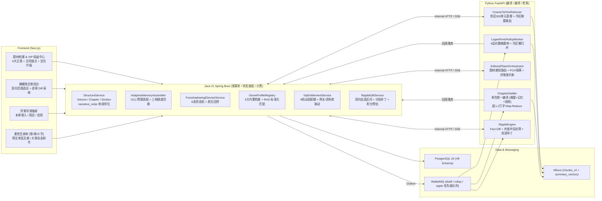
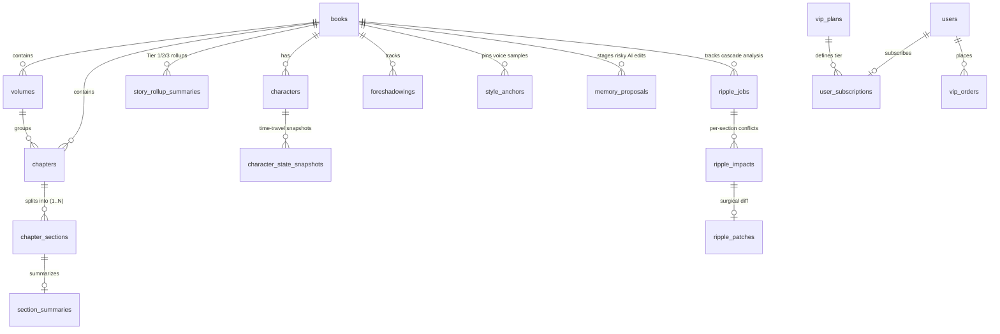

# FoliarcStudio 架构演进总览（Phase 5.8：万章级跨体裁长篇创作引擎）

> **文档导航**
> - 本文：`00-ARCHITECTURE-OVERVIEW.md`（总体架构、数据库 `V8` 迁移蓝图、Milvus 与 MQ 演进、分阶段实施路线）
> - [01-STRUCTURE-AND-MEMORY-SCALE.md](./01-STRUCTURE-AND-MEMORY-SCALE.md)：卷/章/小节三级柔性结构（10 万字大章 + Map-Reduce）、万章级 4 层对数摘要树、章节统一编译、冷热实体休眠 & Coarse-to-Fine RAG
> - [02-FORESHADOWING-DIRECTOR.md](./02-FORESHADOWING-DIRECTOR.md)：伏笔全生命周期导演台（策划/埋入/潜伏/照应/启用/回收 + 原文回捞 + 防提前剧透）、人物别名、POV 信息隔离、按节状态快照与防覆盖锁
> - [03-GENRE-PROFILE-SYSTEM.md](./03-GENRE-PROFILE-SYSTEM.md)：6 大标准主分类 + 副标签题材档案包、分层 Skill 路由、人物 `JSONB` 动态属性、防 AI 味文风锚点与公共 RAG 标准化匹配
> - [04-RIPPLE-EDIT-ENGINE.md](./04-RIPPLE-EDIT-ENGINE.md)：双向自选范围蝴蝶效应链式修改引擎（支持查前文/查后文/双向/按卷框选，Fact Diff → Impact Radar → 稀疏局部 Git Diff 补丁 + VIP 分批熔断）
> - [05-VIP-ENTITLEMENTS-SYSTEM.md](./05-VIP-ENTITLEMENTS-SYSTEM.md)：VIP 会员分级与动态权益中台（4 档套餐控制蝴蝶效应可选章数 50/300/1000/2000~全书、补丁上限、万章记忆档位、个人库容量与网关 RPM/TPM）
> - [06-ADMIN-SYSTEM-SEPARATION.md](./06-ADMIN-SYSTEM-SEPARATION.md)：运营后台独立拆分与 Java Maven 多模块共享内核设计（`apps/admin :3001` + `services/java/{foliarc-common, biz-java :8080, admin-java :8081}`，实现故障/安全/发版物理隔离）

---

## 一、演进目标与核心架构升级

Phase 5.5 落地了首版五层上下文与三层 RAG 知识库，但在真实长篇创作压测中暴露出五大系统性边界：
1. **章节尺度绑定过死**：单章有效无损窗口仅 7,000 字，L2 卷摘放在近章前且从头截断导致 35~60 章即出现近期失忆；同时缺乏“卷/小节”结构，无法兼容《地下室手记》《审判》等单章数万~十万字的古典/严肃文学大章制，也无法支撑千章~万章网络小说。
2. **DB 与记忆抽取存在线性放大隐患**：`StoryMemoryContextService` 拉取全部历史章节正文（5,000 章并发必 OOM）；摘要与记忆抽取把同一章正文喂给 LLM 两遍；`auto_charter` 锁死前 12 章且不看原文。
3. **伏笔停留在“事后记账”**：无埋入/启用导演指令，无防提前剧透策略，L3 无脑 `LIMIT 10` 挤掉新伏笔，按标题精确匹配导致改措辞即失配。
4. **领域模型隐性硬编码“仙侠”**：人物表写死修为境界、路由与审稿偏向修仙打斗、公共库题材靠脆弱子串匹配，无法精准驾驭恐怖灵异、古典历史、悬疑推理等体裁。
5. **修改历史章节缺少双向联动闭环与商业分级**：修改中间章仅更新记忆树，无法双向检查前文铺垫矛盾与后文剧情冲突并生成可审阅补丁；且配额/限流全部写死，缺少 VIP 权益分级治理。

本次演进（统称 **Phase 5.8**）在不破坏现有三端解耦边界的前提下，将平台升级为**兼容“几百章高精度精雕”与“千章~万章稳态远征”、横跨网文与严肃文学的企业级小说引擎**：

---

## 二、核心不变量（Architecture Invariants）

所有子模块实现必须严格遵守以下 8 条不变量：

1. **单调叙事序位 `narrative_order`**：`narrative_order = chapter_no * 1000 + section_no`（`INT64`），全书严格递增。防剧透过滤、记忆快照、伏笔埋设/回收、RAG 热冷分界一律以 `narrative_order` 为准，彻底解耦文学分章习惯与 AI 记忆刻度。
2. **装配复杂度严格 $O(1)$**：任意章节规模（1 章到 10,000 章），单次上下文装配最多查询 PG **≤ 25 行**（绝不拉取全部历史章节正文），最终注入 LLM 的总上下文恒定控制在 **8k ~ 12k Tokens**。
3. **优先级倒置保护**：L2 预算裁剪严格遵循 `L1 上节原文 > Tier 0 近节详摘 > Tier 1 近卷 > Tier 2 近篇 > Tier 3 纪元`，永不允许旧摘要挤掉近节摘要。
4. **作者主权铁律（`author_locked > ai_extracted`）**：不仅 L0 故事宪章，人物关键属性、伏笔定义、大纲与正文均遵守“AI 永不静默覆盖作者手填或锁定的内容”；蝴蝶效应补丁必须经作者逐条 Accept 才写入正文。
5. **零信息截断承诺**：单节存储上限放宽至 **100,000 字符（≈ 300 KB UTF-8）**，单章聚合上限 **200,000 字符**；正文 ≤ 12,000 字单次直编，> 12,000 字自动触发 5,000 字逻辑段 Map-Reduce 并行压缩。
6. **三档自适应精度切换**：
   - `PRECISE`（1 ~ 300 逻辑单元）：全量卷摘 + 活跃角色图谱 + 全书热区直搜。
   - `EXPEDITION`（301 ~ 1,000 单元）：启用 Tier 2 篇摘（100 单元）+ 200 单元未出场配角自动休眠 + RAG 时间加权。
   - `EPIC`（1,001 ~ 10,000+ 单元）：启用 Tier 3 纪元摘（500~1,000 单元）+ 卷作用域隔离 + Coarse-to-Fine 摘要路由检索。
7. **链式修改双向自选 + VIP 分级熔断**：支持作者自由框选前文、后文、双向窗口或指定卷（不再写死向后 500 章），最大可选跨度（50 / 300 / 1,000 / 2,000~全书）与单批补丁上限（5 / 20 / 50 / 100 章）由 **VIP 动态权益中台** 统一治理，超限可分批勾选修复。
8. **100% 向后兼容**：现有 `/api/v1/books/{bookId}/chapters` 全部接口保持契约兼容；未拆小节的章默认映射其唯一的 `is_default = true` 小节，旧客户端与现有测试零破坏。

---

## 三、PostgreSQL 数据库迁移蓝图（Flyway `V9`；VIP 权益表已于 Phase 5.5 `V8` 先行落地）

迁移文件规划：`services/biz-java/src/main/resources/db/migration/V9__phase58_structure_memory_foreshadow_genre_ripple.sql`（VIP 表 `vip_plans` / `user_subscriptions` / `vip_orders` 已提前在 `V8__phase55_vip_entitlements.sql` 完成落地；Phase 6 升级 Maven 多模块后统一收口至 `services/java/foliarc-common/src/main/resources/db/migration/`，且仅由 `biz-java` 执行 Flyway 迁移，详见 [06-ADMIN-SYSTEM-SEPARATION.md](./06-ADMIN-SYSTEM-SEPARATION.md)）。

### 3.1 实体关系总览

### 3.2 新增与变更表清单

| 模块 | 表名 / 变更动作 | 关键字段与索引 | 说明 |
| :--- | :--- | :--- | :--- |
| **结构层** | `CREATE TABLE volumes` | `id, book_id, volume_no, title, arc_goal, pacing_notes, realm_scope, status, start_chapter_no, end_chapter_no` | 显式卷容器，支持填卷纲与地图域 |
| **结构层** | `ALTER TABLE chapters` | `volume_id UUID`, `structure_mode VARCHAR(16)` (`SINGLE` / `MULTI_SECTION`) | 保留原有 `content`/`word_count` 作为聚合缓存与兼容字段 |
| **结构层** | `CREATE TABLE chapter_sections` | `id, book_id, chapter_id, chapter_no, section_no, narrative_order BIGINT, title, content, word_count, content_hash, summary_dirty, is_default, version` | 索引 `uq_sections_book_order(book_id, narrative_order)`，AI 最小调度单元 |
| **结构层** | `CREATE TABLE section_versions` | `id, section_id, version_no, content, change_summary, created_by` | 小节级历史快照，替代大章整篇重复存快照 |
| **摘要树** | `ALTER TABLE chapter_summaries` → 兼容并新增 `section_summaries` | `section_id, chapter_id, narrative_order, time_and_place, summary_text, state_changes, clue_signals, pov_notes, involved_characters, ending_hook, content_hash, status` | 高密度结构化单节摘要；旧 `chapter_summaries` 保留视图/同步兼容 |
| **摘要树** | `CREATE TABLE story_rollup_summaries` | `id, book_id, tier_level INT (1=卷/2=篇/3=纪元), seq_no, volume_id, start_order, end_order, start_chapter_no, end_chapter_no, title, summary_text, open_threads_json, source_hash, status` | 统一多级归并树表，替代固定 10 章单层 `volume_summaries` |
| **题材包** | `ALTER TABLE books` | `genre_code VARCHAR(32) DEFAULT 'XIANXIA_FANTASY'`, `sub_genre_tags VARCHAR(255) DEFAULT ''`, `precision_mode VARCHAR(16) DEFAULT 'AUTO'` | 标准化主类枚举 + 自由副标签 |
| **题材包** | `CREATE TABLE style_anchors` | `id, book_id, title, excerpt_text, sort_order, enabled` | 少样本黄金文风锚点（每书建议 ≤ 3 条，总 ≤ 900 字） |
| **伏笔&实体** | `ALTER TABLE characters` | `aliases TEXT`, `lifecycle_status VARCHAR(24)` (`CORE_PINNED`/`ACTIVE`/`DORMANT`/`DEAD`), `last_seen_order BIGINT`, `arc_scope VARCHAR(120)`, `custom_attributes JSONB DEFAULT '{}'`, `locked_fields JSONB DEFAULT '[]'` | 别名归一 + 冷热休眠 + 题材动态属性 + 字段锁 |
| **伏笔&实体** | `CREATE TABLE character_state_snapshots` | `id, book_id, character_id, narrative_order BIGINT, section_id, snapshot_json JSONB, source VARCHAR(16)` | 按序位时间旅行防剧透快照 |
| **伏笔&实体** | `ALTER TABLE foreshadowings` | `code VARCHAR(16)`, `importance VARCHAR(24)` (`MAIN_ARC`/`SUBPLOT`/`DETAIL`), `reveal_policy VARCHAR(24)` (`HIDE_TRUTH`/`HINT_ONLY`/`REVEAL_NOW`), `planted_section_id UUID`, `planted_narrative_order BIGINT`, `planted_quote TEXT`, `target_chapter_min INT`, `target_chapter_max INT`, `involved_characters TEXT`, `hint_history_json JSONB`, `author_locked BOOLEAN` | 完整 6 态伏笔导演台底座 |
| **记忆回滚** | `ALTER TABLE character_relations` / `timeline_events` | 增加 `source_section_id UUID`, `narrative_order BIGINT`, `source VARCHAR(16)` (`AUTHOR`/`AI_EXTRACTED`), `known_by TEXT` | 支持按节精确撤销旧 AI 抽取记录 & POV 知情范围 |
| **防污染** | `CREATE TABLE memory_proposals` | `id, book_id, section_id, proposal_type, target_entity_id, diff_json JSONB, status` (`PENDING`/`ACCEPTED`/`REJECTED`) | 高危记忆变更（角色死亡/阵营背叛/伏笔自动回收）审批闸门 |
| **公共库** | `ALTER TABLE knowledge_documents` | `genre_codes VARCHAR(255) DEFAULT ''` | 标准化公共库题材代码匹配 |
| **蝴蝶效应** | `CREATE TABLE ripple_jobs` / `ripple_impacts` / `ripple_patches` | 详见 [04-RIPPLE-EDIT-ENGINE.md](./04-RIPPLE-EDIT-ENGINE.md) | 双向自选区间影响雷达、分批补丁与逐段 Diff 持久化 |
| **VIP 权益** | `CREATE TABLE vip_plans` / `user_subscriptions` / `vip_orders` | 详见 [05-VIP-ENTITLEMENTS-SYSTEM.md](./05-VIP-ENTITLEMENTS-SYSTEM.md) | 4 档会员套餐、动态配额 JSONB、到期自动降级与积分折扣 |

### 3.3 老数据零停机平滑回填策略（写在 `V8` 末尾）
1. 为每本已有 `books` 自动生成 1 条默认卷 `Volume 1（第一卷）`，并将现有 `chapters.volume_id` 关联到该卷。
2. 根据现有 `books.genre` 自由文本做启发式映射回填 `books.genre_code`（如含“恐/诡/怪/灵异”→ `HORROR_SUPERNATURAL`，含“古/历/明/清/宋/红楼”→ `CLASSICAL_HISTORICAL`，含“悬疑/推理/侦探”→ `MYSTERY_THRILLER`，含“科幻/末世/赛博”→ `SCIFI_APOCALYPSE`，含“都市/现实/职场”→ `URBAN_REALISM`，其余默认 `XIANXIA_FANTASY`）。
3. 为每条已有 `chapters` 自动插入 1 条 `chapter_sections(section_no=1, narrative_order=chapter_no*1000+1, is_default=true)`，复制其正文、`word_count` 与 `content_hash`。
4. 将已有 `chapter_summaries` 同步回填至 `section_summaries`，已有 `volume_summaries` 迁移为 `story_rollup_summaries(tier_level=1)`。
5. 为已有 `foreshadowings` 顺序补齐 `code`（`#F01`, `#F02`...），将原 `OPEN` 映射为 `PLANTED`（已有 `planted_chapter_no`）或 `PLANNED`（无 `planted_chapter_no`）。

---

## 四、Milvus 与 RabbitMQ 基础设施演进

### 4.1 Milvus 双集合架构与升级方案
现有集合 `foliarc_novel_chunks` 定义了 `enable_dynamic_field=False`（[vector_store.py#L175](file:///root/agent-project/foliarc-studio/services/agent-py/src/foliarc_agent/rag/vector_store.py#L175)），无法在已有集合原位追加标量字段，因此采用**版本化新集合 + 自动懒迁移**：

1. **正文/设定精细集合 `foliarc_novel_chunks_v2`**：
   - 在现有字段基础上新增：
     - `narrative_order: INT64`（建 `INVERTED` 索引，替代 `chapter_no` 执行小节级防剧透预过滤与热区区间过滤）；
     - `section_id: VARCHAR(64)`（支持单小节修改后精准按 `section_id` 清理重建，无需重写整个 10 万字大章）。
   - 保留 `book_id` 为 Partition Key（16 分区）、Dense HNSW (COSINE) + 原生中文 BM25 + `RRFRanker(k=60)`。
2. **新增轻量摘要路由集合 `foliarc_summary_vectors`**（Coarse-to-Fine 专用）：
   - 仅存储 `section_summaries` 和 `story_rollup_summaries` 的向量与 BM25 索引（万章小说也仅 ~1.1 万行，内存占用极低）；
   - 字段：`node_id (PK)`, `book_id (Partition Key)`, `owner_id`, `tier_level (0/1/2/3)`, `start_order`, `end_order`, `chapter_no`, `content (Chinese BM25)`, `dense_vec`, `sparse_vec`。
   - 超过 300 单元的远古剧情打捞时，先查本集合定位 2~3 个精确 `narrative_order` 区间，再回查 `foliarc_novel_chunks_v2` 精准取原文父块。

### 4.2 RabbitMQ 队列优先级拓扑演进
在原有 `foliarc.rag.exchange` 上调整为 **7 条职责隔离队列（均配独立 DLQ）**：

| 队列名 | Routing Key | 通道与 Prefetch | 职责 |
| :--- | :--- | :--- | :--- |
| `foliarc.rag.chapter.ingest.queue` | `rag.chapter.ingest` | Fast Channel (`prefetch=6`) | 小节实时切片与双写向量库 |
| `foliarc.rag.delete.queue` | `rag.delete` | Fast Channel (`prefetch=6`) | 文档/小节软删除异步清 Milvus |
| `foliarc.memory.distill.queue` | `memory.distill` | Fast Channel (`prefetch=6`) | **章节统一编译**（单次 LLM 同时产出单节摘要 + 结构化记忆 + 快照 + 摘要向量入库），取代原双发 `memory.summary` + `memory.extract` |
| `foliarc.memory.rollup.queue` | `memory.rollup` | Normal Channel (`prefetch=4`) | 多级摘要归并（卷/篇/纪元）与 L0 自动宪章低频刷新（远古章走 3~5 分钟去重懒归并） |
| `foliarc.ripple.analyze.queue` | `ripple.analyze` | Normal Channel (`prefetch=2`) | 双向/自定义范围蝴蝶效应 Fact Diff + Impact Radar 并发影响扫描 |
| `foliarc.ripple.patch.queue` | `ripple.patch` | Bulk Channel (`prefetch=2`) | 分批受影响章（按 VIP 上限 5~100 章）稀疏局部 Diff 补丁生成 |
| `foliarc.rag.ingest.queue` | `rag.ingest` | Bulk Channel (`prefetch=2`) | 大体积 PDF/DOCX/TXT 参考资料导入（隔离防止饿死实时写作） |

---

## 五、分阶段垂直实施路线（待审阅确认后启动）

为避免大规模一次性改动导致三端失控，按 **4 个可独立编译与单测验收的垂直切片** 推进：

| 子阶段 | 核心交付范围 | 验收里程碑 |
| :--- | :--- | :--- |
| **Phase 5.8A：结构底座 + 万章记忆引擎** | `V8` 数据库迁移（含老数据回填）、`Volume / Chapter / Section` API（100% 兼容旧章接口）、单章 10 万字 & Map-Reduce 摘要、4 层对数摘要树 + 统一编译 `ChapterDistiller`、修掉全表拉正文 OOM 与 L2 倒置截断、Milvus `v2` + `summary_vectors` Coarse-to-Fine 检索、前端柔性目录树（卷/章/小节） | ① 零设定连写/压测模拟 1,500 章上下文组装恒定 < 20ms & 3k~4k 字；② 粘贴 3 万字大章无截断摘要且小节级防剧透不穿帮；③ 回滚/删节正确触发脏标记重算 |
| **Phase 5.8B：伏笔导演台 + 连续性防线** | 伏笔 6 态状态机 + 原文回捞 + 本章埋入/照应/启用指令注入 + 防剧透策略、人物 `aliases` 归一 + 冷热休眠/唤醒 + `character_state_snapshots` 按节时间旅行 + `memory_proposals` 高危闸门 + POV 知识边界 + 前端伏笔导演抽屉 | ① 勾选「本章埋入」与「本章启用」能精准回捞远古埋设原句并由 Critic 核验；② `HIDE_TRUTH` 伏笔不再被 AI 提前挑破；③ 200 章未出场配角自动休眠，点名重逢时瞬时唤醒 |
| **Phase 5.8C：题材档案包 + 风格引擎** | 内置 6 大主分类 `GenreProfile`（仙侠/恐怖/古典/悬疑/科幻/都市）、新增 6+ 套题材专属 Skill、`IntentAndModelRouter` 题材池路由、人物 `JSONB` 动态表单、Critic 差异化 Rubric、`style_anchors` 黄金文风锚点、公共 RAG `genre_codes` 匹配 | ① 新建“中式民俗恐怖”和“明清古典世情”两本书，前端人物表自动切换专属字段、Router 自动匹配对应 Skill、Critic 不再误审“修为境界”；② 公共库精准按题材挂载 |
| **Phase 5.8D：VIP 权益中台 + 双向蝴蝶效应引擎** | `vip_plans` / `user_subscriptions` / `VipEntitlementService`（联动蝴蝶效应范围 50/300/1000/2000~全书、个人库容量、网关 RPM/TPM 与积分折扣）、`Fact Diff` 原子变更提取、双向/自选区间 `Impact Radar` 影响雷达（区分前文倒推与后文冲突）、分批 `Sparse Surgical Patch` 局部 Diff 补丁、前端会员权益中心 + 蝴蝶效应范围选择器与审阅台 | ① 不同 VIP 档位动态生效（FREE 选超 50 章返回 `403 VIP_QUOTA_EXCEEDED` 引导升级，SVIP 流畅扫 1,000 章）；② 修改中间章可同时定位前文铺垫矛盾与后文剧情冲突；③ 逐章采纳补丁后自动同步快照与摘要树 |
