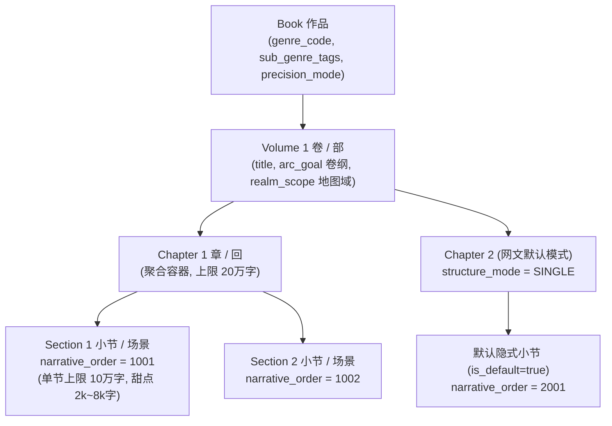
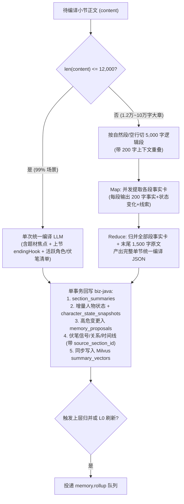
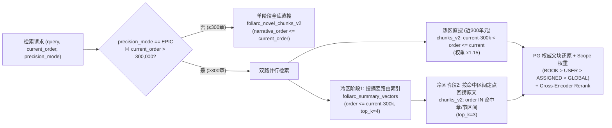

# 01｜三级柔性文学结构与万章级分层记忆架构设计

> 对应子阶段：**Phase 5.8A**
> 核心解决：**同时兼容“网文万章连载（2k~5k/章）”与“古典/严肃文学大章制（单章 10 万字，如《地下室手记》《审判》）”**，并彻底消除现存代码在 35~60 章的截断失效和 5,000 章的 DB OOM 地雷。

---

## 一、三级柔性文学结构（Volume → Chapter → Section）

### 1.1 领域模型与单调叙事刻度 `narrative_order`

现有 `books → chapters` 模型将“作者的出版目录结构”与“AI 的记忆处理单元”强耦合在一起。升级后引入 **三层柔性容器 + 统一逻辑刻度**：



- **叙事序位公式**：
  $$\text{narrative\_order} = \text{chapter\_no} \times 1000 + \text{section\_no}$$
  - 每章最多支持 999 个小节；支持高达百万章而不溢出 `BIGINT`。
  - **同构效应**：在 AI 记忆引擎眼里，“2 部 × 15 小节的《地下室手记》”与“30 章 × 单节的网文”，底层都是 **30 个严格递增的逻辑单元**。
- **字数与字节边界策略**：
  - **单小节（`chapter_sections.content`）**：接口硬上限 **100,000 字符（≈ 300 KB UTF-8）**；前端超过 8,000 字温和提示“建议按场景拆分小节以获得更精准的防剧透与增量重算”，但不强制阻断。
  - **单章聚合（`chapters`）**：允许旗下多小节累计至 **200,000 字符（≈ 600 KB UTF-8）**。
  - **向下兼容铁律**：
    - 当 `chapters.structure_mode = 'SINGLE'`（默认网文模式）时，调用旧接口 `GET/PUT /api/v1/books/{bookId}/chapters/{chapterId}` 自动透明读写该章唯一的 `is_default = true` 小节，并同步更新 `chapters.content` 与 `chapters.word_count` 缓存。
    - 当作者点击「拆分为小节」或新增第 2 个小节时，章自动切换为 `MULTI_SECTION`，编辑器切换为按小节懒加载（每次保存仅传单个小节 ~10 KB），同时提供「整章预览 / 导出」视图无缝拼接全部小节。

### 1.2 核心表结构 DDL（节选）

```sql
CREATE TABLE volumes (
    id               UUID         PRIMARY KEY DEFAULT gen_random_uuid(),
    book_id          UUID         NOT NULL REFERENCES books(id) ON DELETE CASCADE,
    owner_id         UUID         NOT NULL REFERENCES users(id) ON DELETE CASCADE,
    volume_no        INT          NOT NULL,
    title            VARCHAR(200) NOT NULL DEFAULT '',
    arc_goal         TEXT         NOT NULL DEFAULT '',  -- 本卷核心目标/卷纲（往前看导航！）
    pacing_notes     TEXT         NOT NULL DEFAULT '',  -- 节奏与情绪弧（如：铺垫→升级→卷末高潮）
    realm_scope      VARCHAR(120) NOT NULL DEFAULT '',  -- 当前地图/阶段作用域（如：人界南域 / 民国江南）
    start_chapter_no INT,
    end_chapter_no   INT,
    status           VARCHAR(24)  NOT NULL DEFAULT 'WRITING', -- PLANNING / WRITING / COMPLETED
    created_at       TIMESTAMPTZ  NOT NULL DEFAULT NOW(),
    updated_at       TIMESTAMPTZ  NOT NULL DEFAULT NOW(),
    CONSTRAINT uq_volumes_book_no UNIQUE (book_id, volume_no)
);

CREATE TABLE chapter_sections (
    id               UUID         PRIMARY KEY DEFAULT gen_random_uuid(),
    book_id          UUID         NOT NULL REFERENCES books(id) ON DELETE CASCADE,
    chapter_id       UUID         NOT NULL REFERENCES chapters(id) ON DELETE CASCADE,
    chapter_no       INT          NOT NULL,
    section_no       INT          NOT NULL DEFAULT 1,
    narrative_order  BIGINT       NOT NULL,
    title            VARCHAR(200) NOT NULL DEFAULT '',
    content          TEXT         NOT NULL DEFAULT '',
    word_count       INT          NOT NULL DEFAULT 0,
    content_hash     VARCHAR(64)  NOT NULL DEFAULT '',
    summary_dirty    BOOLEAN      NOT NULL DEFAULT FALSE,
    is_default       BOOLEAN      NOT NULL DEFAULT FALSE,
    version          BIGINT       NOT NULL DEFAULT 0,
    created_at       TIMESTAMPTZ  NOT NULL DEFAULT NOW(),
    updated_at       TIMESTAMPTZ  NOT NULL DEFAULT NOW(),
    CONSTRAINT uq_sections_chapter_no UNIQUE (chapter_id, section_no),
    CONSTRAINT uq_sections_book_order UNIQUE (book_id, narrative_order)
);
CREATE INDEX idx_sections_book_order_desc ON chapter_sections (book_id, narrative_order DESC);
```

---

## 二、万章级 4 层对数摘要压缩树与三档自适应精度

### 2.1 三档精度自动切换规则

根据当前小节之前的已完成逻辑单元总数 $U$（`COUNT(*) FROM chapter_sections WHERE book_id = ? AND narrative_order < current_order`）自动判定（亦支持书目手动覆盖）：

| 模式 | 逻辑单元规模 $U$ | L2 摘要树装配策略 | L3 实体策略 | L4 RAG 策略 |
| :--- | :--- | :--- | :--- | :--- |
| **`PRECISE`（精密模式）** | $U \le 300$ | 近 10 节详摘 + 之前全部 Tier 1 卷摘（最多 ~28 卷精简版） | 全量活跃角色 + 完整关系网 + 伏笔导演台 | 全书热区直搜 |
| **`EXPEDITION`（远征模式）** | $300 < U \le 1000$ | 近 10 节详摘 + 当前篇内 Tier 1 卷摘（≤ 8 卷）+ 历史 Tier 2 篇摘（100 单元/篇） | 超过 200 单元未出场配角自动休眠为 `DORMANT` | 近 300 单元时间加权 + 远古摘要辅助 |
| **`EPIC`（万章史诗模式）** | $U > 1000$ | 近 8~10 节详摘 + 近 5 卷 Tier 1 + 近 3~4 篇 Tier 2 + 全书 Tier 3 纪元编年史（每 500~1,000 单元 1 条，≤ 10 条） | 按 `volume.realm_scope` 隔离旧地图设定 + 非核心配角/小伏笔全入冷库（点名即唤醒） | **Coarse-to-Fine 两阶段路由**（热区 300 单元直搜 + 冷区先搜摘要再捞原文） |

### 2.2 统一多级归并表 `story_rollup_summaries`

彻底替代原只能按 10 章平铺的 `volume_summaries`：

```sql
CREATE TABLE story_rollup_summaries (
    id               UUID        PRIMARY KEY DEFAULT gen_random_uuid(),
    book_id          UUID        NOT NULL REFERENCES books(id) ON DELETE CASCADE,
    owner_id         UUID        NOT NULL REFERENCES users(id) ON DELETE CASCADE,
    tier_level       INT         NOT NULL,  -- 1=卷摘(10单元/显式卷), 2=篇摘(100单元), 3=纪元编年史(500~1000单元)
    seq_no           INT         NOT NULL,
    volume_id        UUID        REFERENCES volumes(id) ON DELETE SET NULL,
    start_order      BIGINT      NOT NULL,
    end_order        BIGINT      NOT NULL,
    start_chapter_no INT         NOT NULL,
    end_chapter_no   INT         NOT NULL,
    title            VARCHAR(200) NOT NULL DEFAULT '',
    summary_text     TEXT        NOT NULL,
    open_threads     TEXT        NOT NULL DEFAULT '',  -- 显式保留的跨卷/跨篇未回收暗线
    source_hash      VARCHAR(64) NOT NULL DEFAULT '',
    status           VARCHAR(24) NOT NULL DEFAULT 'READY', -- READY / STALE
    created_at       TIMESTAMPTZ NOT NULL DEFAULT NOW(),
    updated_at       TIMESTAMPTZ NOT NULL DEFAULT NOW(),
    CONSTRAINT uq_rollup_book_tier_seq UNIQUE (book_id, tier_level, seq_no)
);
CREATE INDEX idx_rollup_book_tier_order ON story_rollup_summaries (book_id, tier_level, end_order);
```

- **卷归并边界规则**：若作者在 `volumes` 表里显式划分了卷（且该卷包含 ≥ 3 个逻辑单元），Tier 1 优先按显式卷边界归并；若单卷超过 15 个单元（常见于网文 100 章一大卷），自动切分为 `卷内子卷（每 10 单元 1 条 Tier 1）`，再由整个大卷构成 Tier 2 篇摘。
- **彻底解决现存 4 大 Bug**：
  1. **消除 L2 头部截断吞噬近章**：`AdaptiveMemoryAssembler` 在 Java 侧严格按 **反向预算填充**——先保留全部近 8~10 节详摘（配额 `1,600` 字），剩余配额依次填入近卷（`1,000` 字）、近篇（`800` 字）、纪元编年史（`700` 字），总字符严格封顶 **4,100 字**；Python 侧取消粗暴 `[:2400]` 截断。
  2. **消除卷摘与近 10 节重叠**：查询 Tier 1/2/3 时强制条件 `end_order < recent_start_order`（已覆盖进近 10 节窗口的卷绝不重复输出整卷摘要）。
  3. **消除全表拉正文 OOM**：L1 热窗口改用单行 SQL：
     ```sql
     SELECT id, chapter_no, section_no, title, content, narrative_order
     FROM chapter_sections
     WHERE book_id = :bookId AND narrative_order < :currentOrder AND word_count > 0
     ORDER BY narrative_order DESC
     LIMIT 1
     ```
     整个五层上下文装配固定只查 PG **≤ 25 行**，10,000 章耗时仍 < 15ms。
  4. **补齐全部脏标记盲区**：
     - `rollbackToVersion` / `deleteSection` / `deleteChapter` 均更新 `content_hash` 并把所属 Tier 1/2/3 标 `STALE`；
     - 取消草稿态 `>= 120 字差值` 才触发的漏洞：改为 **基于 Redis 3 分钟去重防抖队列**（`summary_dirty = true` 超过 3 分钟无新编辑，或作者触发 AI 生成前发现前章 `summary_dirty = true`，立刻自动编译）；
     - 距最新章 > 500 单元的远古章改动，仅实时编译单节摘要与向量，上层 Tier 1/2/3 标 `STALE` 交由后台低优批任务定时懒归并，防级联风暴。

---

## 三、章节统一编译引擎（ChapterDistiller）与大章 Map-Reduce

### 3.1 合并摘要与记忆抽取（降本 45% + 消除自相矛盾）

旧架构每章定稿分别发 `memory.summary` 和 `memory.extract` 两条队列、把同一章正文喂给 LLM 两遍。新架构合并为单次 **`ChapterDistiller.distill_section()`**（强制开启 `response_format={"type": "json_object"}`）：



### 3.2 优化版核心 Prompt 规范

#### A. 单节统一编译 Prompt（`ChapterDistiller`）
- **输入要素**：`题材关注焦点（来自 GenreProfile）` + `当前卷纲（arc_goal）` + `上一节 endingHook` + `活跃角色名单与别名（≤40 人）` + `待追踪伏笔编号清单（#F01..#F25）` + `本节正文`。
- **输出 JSON Schema**：
```json
{
  "summary": {
    "timeAndPlace": "故事内时间推进与地点变迁（如：三更→拂晓；荒村祠堂→后山枯井）",
    "summaryText": "140~220字客观高密度梗概（交代承接上节、核心冲突、转折与明确结果）",
    "stateChanges": "不可逆硬事实变更（伤亡/道具得失/能力或规则变动；无则空）",
    "clueSignals": "新埋异常细节、暗线照应或旧伏笔回收；无则空",
    "povNotes": "本节叙事视角与关键信息差（谁得知秘密、谁仍蒙在鼓里）",
    "involvedCharacters": ["林青", "苏晚"],
    "endingHook": "一句话概括本节结尾画面与下节必须承接的危机/动作"
  },
  "memory": {
    "characterUpdates": [
      {
        "name": "标准角色名（须与已知角色或别名归一）",
        "aliases": ["新出现的外号或称谓"],
        "lifecycleStatus": "ACTIVE|DEAD",
        "currentLocation": "本节结束位置",
        "statusNotes": "伤势/心境/状态变更",
        "inventoryDelta": "新增或失去的物品",
        "customAttributes": {"字段名": "题材专属属性值（如理智值/官职/修为）"},
        "isHighRisk": false
      }
    ],
    "foreshadowingSignals": [
      {
        "code": "#F03（匹配已有伏笔则填编号，新埋填 null）",
        "action": "PLANTED|HINTED|RESOLVED",
        "title": "15字以内简短标题",
        "quote": "原文中最具代表性的 1~2 句线索原话",
        "description": "线索含义与进展"
      }
    ],
    "relations": [
      {
        "sourceCharacter": "角色A",
        "targetCharacter": "角色B",
        "relationType": "关系类型",
        "description": "本节事件体现的关系变动",
        "knownBy": "知晓此关系或事件的范围（如：公开 / 仅角色A与反派）"
      }
    ],
    "timelineEvents": [
      {
        "inStoryTime": "故事内时间点",
        "eventTitle": "核心事件（20字以内）",
        "summary": "60字以内客观事实（人物口述/谎言须注明“XX声称”）",
        "involvedCharacters": "角色A, 角色B",
        "location": "地点",
        "knownBy": "知情人物列表"
      }
    ]
  }
}
```
- **硬规则约束**：
  1. 严格区分**客观事实**与**人物口述/猜测/谎言**（角色声称的内容必须加注“XX声称/怀疑”）；
  2. 若检测到角色死亡、核心阵营背叛、或疑似回收作者锁定的主线伏笔，自动标记 `isHighRisk = true`，进入 `memory_proposals` 待作者一键确认，不静默覆盖。

#### B. 卷 / 篇 / 纪元多级归并 Prompt（`LogarithmicRollup`）
- **Tier 1 卷摘（输入全部单节的 `summaryText + stateChanges + clueSignals`，320~420 字 4 行微结构）**：
  - `- 主线推进：`
  - `- 人物与格局：`（按题材动态替换术语，不再写死“境界”）
  - `- 硬事实与遗留物：`（死亡名单、关键道具、确立铁律）
  - `- 未解暗线：`（跨卷仍未回收的伏笔编号与悬念）
- **Tier 2 篇摘（10 卷 → 1 篇，220~300 字）**：只保留改变大局势的阶段性结局、主角团核心成长、新旧地图转换与主线伏笔推进，删去已完结的副本过渡细节。
- **Tier 3 纪元编年史（5~10 篇 → 1 纪元，80~120 字）**：一句话概括本 500~1000 章的大时代主题、主要敌对势力结局与进入下一纪元的契机。

#### C. 自动涌现式 L0 故事宪章升级（修复“不看正文盲猜文风”缺陷）
- **输入升级**：`前序卷/篇摘要` + `最近 3 节摘要` + **`2 段原作正文采样（第 1 节前 500 字 + 最新节前 500 字）`** + `上一版旧宪章（增量演进防抖动）` + `题材档案名称`。
- **输出 5 行静态档案**：`核心主线` / `叙事视角与人称（基于原文采样确认）` / `文风节奏质感（基于原文采样归纳）` / `已确立世界观与硬规则` / `叙事禁忌底线`。
- **永不覆盖铁律**：若 `books.charter_source == 'AUTHOR_DEFINED'`，跳过刷新。

---

## 四、L3 冷热实体休眠 & L4 Coarse-to-Fine 万章检索

### 4.1 L3 角色与伏笔自然衰减（不丢数据，只降噪音）
- **角色自动休眠**：每次编译更新出场角色的 `last_seen_order = current_order`。当进入 `EXPEDITION` / `EPIC` 模式时，筛选 L3 活跃角色与编译候选池仅加载 `lifecycle_status IN ('CORE_PINNED', 'ACTIVE')`（若非核心角色 `current_order - last_seen_order > 200_000` 即超过 200 章未出场，后台归档任务自动降级为 `DORMANT`）。
- **瞬时唤醒（Re-hydration）**：当作者在指令、当前节正文或大纲中提到某 `DORMANT` 角色的姓名或任一 `alias` 时，`AdaptiveMemoryAssembler` 自动将其从冷库捞出并拉回 `ACTIVE`，同时附带其最后一次出场快照，实现“第 3,500 章故人重逢依然无缝衔接”。
- **死亡墓碑（Tombstone）**：`lifecycle_status = 'DEAD'` 的角色不占正文活跃配额，仅以极短单行列表注入 Critic（`已亡角色红线：二长老(Ch.48), 林默(Ch.122)`），杜绝写着写着“死人复活”。

### 4.2 L4 万章级 Coarse-to-Fine 两阶段混合检索



- **收益**：万章小说（10 万+ Child Chunk）下，近 300 章保持与百章小说完全一致的细粒度召回精度；300 章以前的远古设定与伏笔通过信噪比极高的摘要索引先定位再回捞原文，彻底避免语义稀释与无关日常干扰。
