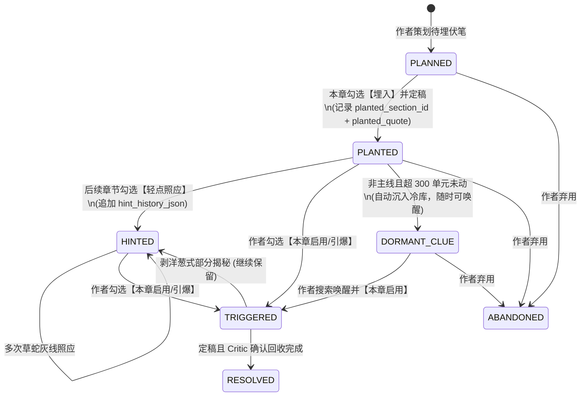

# 02｜伏笔全生命周期导演台与长篇连续性防线

> 对应子阶段：**Phase 5.8B**
> 核心解决：将现有“事后被动记账本”升级为**事前主动导演台（埋入 / 潜伏防剧透 / 轻点照应 / 启用引爆 + 原文精准回捞）**，并系统性补齐人物别名归一、POV 信息不对称隔离、按节时间旅行状态快照与 AI 记忆防污染闸门。

---

## 一、伏笔全生命周期导演台（Foreshadowing Director）

### 1.1 为什么原有伏笔表不够用？
1. **缺少“事前导演指令”**：以前只能把最多 10 条 `OPEN` 伏笔平铺塞进 L3，AI 不知道作者打算这一章埋什么、藏什么、还是揭晓什么。
2. **AI 容易“嘴碎提前剧透”**：一旦把暗线真相写进 `description` 喂给 Writer，大模型极易提前把藏了 50 章的反转在第 8 章说破。
3. **标题精确匹配极脆弱**：`LoreService.upsertForeshadowing` 靠 `title` 完全相等更新，LLM 只要把“残缺玉佩”改写为“林青的残缺玉佩”就会重复建新条目、旧伏笔永远关不掉。
4. **跨百章回收难靠模糊 RAG 捞回原句**：写第 180 章回收第 4 章的伏笔时，单靠通用语义检索不一定能把第 4 章那句关键细节捞出来。

### 1.2 六态生命周期状态机



### 1.3 数据库字段扩展（`foreshadowings`）

```sql
ALTER TABLE foreshadowings
    ADD COLUMN IF NOT EXISTS code                    VARCHAR(16) NOT NULL DEFAULT '',       -- 书内唯一短码 #F01, #F02...
    ADD COLUMN IF NOT EXISTS importance              VARCHAR(24) NOT NULL DEFAULT 'SUBPLOT',-- MAIN_ARC / SUBPLOT / DETAIL
    ADD COLUMN IF NOT EXISTS reveal_policy           VARCHAR(24) NOT NULL DEFAULT 'HIDE_TRUTH', -- HIDE_TRUTH / HINT_ONLY / REVEAL_NOW
    ADD COLUMN IF NOT EXISTS surface_clue            TEXT        NOT NULL DEFAULT '',       -- 表面现象（给读者/Writer看）
    ADD COLUMN IF NOT EXISTS hidden_truth            TEXT        NOT NULL DEFAULT '',       -- 真实底牌（仅在 REVEAL_NOW 或 Critic 防冲突时可见！）
    ADD COLUMN IF NOT EXISTS planted_section_id      UUID        REFERENCES chapter_sections(id) ON DELETE SET NULL,
    ADD COLUMN IF NOT EXISTS planted_narrative_order BIGINT,
    ADD COLUMN IF NOT EXISTS planted_quote           TEXT        NOT NULL DEFAULT '',       -- 当年埋设原文锚点句
    ADD COLUMN IF NOT EXISTS resolved_section_id     UUID        REFERENCES chapter_sections(id) ON DELETE SET NULL,
    ADD COLUMN IF NOT EXISTS target_chapter_min      INT,                                   -- 计划回收起始章（到期高亮提醒）
    ADD COLUMN IF NOT EXISTS target_chapter_max      INT,                                   -- 计划回收截止章
    ADD COLUMN IF NOT EXISTS involved_characters     TEXT        NOT NULL DEFAULT '',
    ADD COLUMN IF NOT EXISTS hint_history_json       JSONB       NOT NULL DEFAULT '[]'::jsonb,
    ADD COLUMN IF NOT EXISTS source                  VARCHAR(16) NOT NULL DEFAULT 'AUTHOR', -- AUTHOR / AI_EXTRACTED
    ADD COLUMN IF NOT EXISTS author_locked           BOOLEAN     NOT NULL DEFAULT FALSE;

CREATE UNIQUE INDEX IF NOT EXISTS uq_foreshadowings_book_code
    ON foreshadowings (book_id, code) WHERE code <> '';
```

> **防提前剧透核心设计（双层真相隔离）**：
> 将原本混在一起的 `description` 明确拆分为 **`surface_clue`（表面线索，可写出来）** 与 **`hidden_truth`（幕后真相，默认严禁暴露）**！
> - 当伏笔处于 `PLANTED` / `HINTED` 且 `reveal_policy = HIDE_TRUTH` 时：**Writer 只能看到 `surface_clue` + “严禁点破真相”红线**，只有 Critic 能读到 `hidden_truth` 用来防止正文写出逻辑穿帮！
> - 只有当作者明确勾选「本章启用（`PAYOFF`）」时，系统才把 **`hidden_truth` + 当年埋设原文段落** 完整解锁交给 `Director` 和 `Writer`！

### 1.4 创作流「本章埋入 / 照应 / 启用」全链路协议

#### Step 1：前端导演抽屉选择指令
在工作台右侧写作区新增 **「本章伏笔指令」** 快捷槽，支持三类一键勾选（默认建议每章总数 ≤ 2~3 条防信息过载）：
- **埋入（`PLANT`）**：从 `PLANNED` 列表选 1~2 条；
- **照应（`HINT`）**：从 `PLANTED / HINTED` 列表选 1 条（草蛇灰线轻点一次，不挑破）；
- **启用引爆（`PAYOFF`）**：从 `PLANTED / HINTED / DORMANT_CLUE` 列表选 1~2 条（支持标记 `FULL_RESOLVE` 彻底回收 或 `PARTIAL_REVEAL` 阶段性揭秘）。
- 若某条伏笔的 `target_chapter_min <= current_chapter_no <= target_chapter_max`，抽屉顶部自动浮出 **「到期回收提醒」** 徽章，作者一键即可加入本章启用。

#### Step 2：扩展 `StartRunRequest` 协议
```json
{
  "bookId": "...",
  "chapterId": "...",
  "sectionId": "...",
  "foreshadowingDirectives": [
    { "foreshadowingId": "uuid-1", "mode": "PLANT" },
    { "foreshadowingId": "uuid-2", "mode": "HINT" },
    { "foreshadowingId": "uuid-3", "mode": "PAYOFF", "resolveType": "FULL_RESOLVE" }
  ]
}
```

#### Step 3：多 Agent 编辑部精准执行与原文回捞
1. **`AdaptiveMemoryAssembler`（Java 侧精确回捞，不靠模糊 RAG）**：
   - 对每一条 `HINT` / `PAYOFF` 指令，直接通过 `planted_section_id` 从 `chapter_sections` 精准查出当年埋设的上下文片段（以 `planted_quote` 为中心前后各取 400 字；若无 `planted_quote` 则取该节摘要 + 片段），打包成 **`【本章强制伏笔导演包（最高优先级）】`** 注入黑板。
   - L3 普通伏笔槽位改按优先级填充：`本章导演指令（必进，不计入限额） > 当前出场角色强关联伏笔（≤4条） > 到期主暗线（≤4条）`，彻底告别无脑 `LIMIT 10`。
2. **`Director`（总编）**：强约束必须为每条 `PLANT / HINT / PAYOFF` 指令分配明确场景节拍，且 `PLANT` 须遵循冰山原则藏入动作/物件细节。
3. **`Writer`（执笔作家）**：严格按每条指令的 `mode` 与 `reveal_policy` 落笔；`PLANT` 和 `HINT` 只见 `surface_clue`、`PAYOFF` 解锁 `hidden_truth` 与当年原文原句，确保细节严丝合缝。
4. **`ContinuityCritic`（审稿编辑）**：新增专项审查项：
   - 本章指定的 `PLANT` 伏笔是否自然埋入且未生硬说教？
   - 本章指定的 `PAYOFF` 伏笔是否与当年埋设原文（时间/物品/称谓/细节）零矛盾？
   - 处于 `HIDE_TRUTH` 状态的潜伏伏笔有没有被意外提前剧透？
5. **自动状态流转与回写**：正文采纳保存后，后端根据本次指令与 `ChapterDistiller` 的校验结果：
   - `PLANT` 成功 → 状态更新为 `PLANTED`，自动回填 `planted_section_id / planted_chapter_no / planted_narrative_order / planted_quote`；
   - `HINT` 成功 → 状态更新为 `HINTED`，向 `hint_history_json` 追加 `{chapterNo, sectionNo, quote}`；
   - `PAYOFF(FULL_RESOLVE)` 成功 → 若伏笔 `author_locked=true`，推送一条一键确认卡片或经作者确认后置为 `RESOLVED` 并记录 `resolved_section_id`。

---

## 二、长篇连续性四大防线补强

### 2.1 人物别名表（`aliases`）与精确实体归一
- **痛点**：古典/悬疑/仙侠中同一人常有本名、字号、官职、外号（如“林青 / 青儿 / 林大人 / 血衣客”）。现有代码靠 `contextProbe.contains(c.name())` 和 `name = ?` 精确匹配，极易漏召回且把同一人拆成多个角色。
- **设计**：
  - `characters.aliases` 存储逗号分隔别名（如 `青儿,林师兄,血衣客`）；
  - Java 侧构建书内内存映射表 `alias -> canonicalCharacter` 供 L3 匹配、冷库唤醒与蝴蝶效应雷达共享；
  - `ChapterDistiller` 提示词喂入 `标准名(别名1/别名2)`，强制要求模型按标准名输出更新，新发现的称谓自动合并进 `aliases`。

### 2.2 POV 视角与角色知识边界（Information Asymmetry）
- **痛点**：恐怖、悬疑、权谋小说中，第 5 章反派暗中设局时主角不在场，现有全知视角的 L2/L3 记忆会导致第 12 章主角无端“读心术”提前识破。
- **设计**：
  - `chapter_sections` / `StartRunRequest` 支持可选指定 `pov_character`（默认沿用 L0 故事宪章的主视角）；
  - `timeline_events` 与 `character_relations` 新增 `known_by` 字段（如 `PUBLIC` 全员皆知，或逗号分隔知情角色名单 `林青,苏晚`）；
  - 装配给 Writer 的 L3 简报强制拆为两栏：
    - **【当前视角角色已知事实】**（角色可在内心独白与对话中直接引用）
    - **【幕后客观事实（当前视角尚不知情，仅防世界观穿帮，严禁主角凭空知晓！）】**
  - Critic 同步校验是否出现“视角越权/角色读心术”。

### 2.3 按序位状态快照（Time-Travel Snapshots）与精准回滚
- **痛点**：现有 `characters` 只存最新终态，写到第 60 章回头精修第 12 章时，第 60 章的修为、伤势与法宝会倒灌剧透到第 12 章；且修改第 12 章删掉某事件后，之前自动抽取进 `character_relations` / `timeline_events` 的旧记录会成为幽灵记忆永不消失。
- **设计**：
  1. **按节快照表 `character_state_snapshots`**：每次 `ChapterDistiller` 编译第 `order` 节时，为本节状态发生变动的角色落一条 `(character_id, narrative_order, section_id, snapshot_json)` 快照。
  2. **时间旅行查询**：当作者在编辑历史上某一节（`current_order < max_book_order`）时，L3 不再读 `characters` 最新终态，而是查询每个活跃角色 **`narrative_order <= current_order` 的最新一条快照**！
  3. **按源节精确回滚**：`character_relations`、`timeline_events`、`character_state_snapshots` 均记录 `source_section_id` 与 `source (AUTHOR | AI_EXTRACTED)`。当某一节被重写并重新编译时，事务内先 `DELETE ... WHERE source_section_id = :sectionId AND source = 'AI_EXTRACTED'`，再写入新抽取事实——**绝不误删作者手填记录，也绝不残留幽灵旧记忆**！

### 2.4 AI 自动记忆防污染闸门（字段锁 + `memory_proposals`）
- **字段级保护（`characters.locked_fields JSONB`）**：作者在设定面板手动编辑并锁定了某角色的 `personality` 或 `realm_or_level` 后，自动记忆抽取管线对该字段自动跳过，遵循 **`author_locked > ai_extracted`**。
- **高危变更审批队列（`memory_proposals`）**：以下 3 类不可逆高危自动抽取不直接覆盖主表，而是写入 `memory_proposals(status='PENDING')` 在前端设定栏弹出轻量红点提示，作者一键「采纳 / 驳回」：
  1. 角色状态变为 `DEAD`（防止把反派吹牛“杀了他”误判成真死）；
  2. 涉及作者已锁定（`author_locked=true`）的伏笔疑似被标记为 `RESOLVED`；
  3. 核心主角团（`CORE_PINNED`）的关键阵营/身份发生剧变。

---

## 三、新增 REST API 契约清单

| 方法与路径 | 用途 |
| :--- | :--- |
| `POST /api/v1/books/{bookId}/lore/foreshadowings` | 创建/更新伏笔（含 `importance / revealPolicy / surfaceClue / hiddenTruth / targetChapterMin~Max`） |
| `POST /api/v1/books/{bookId}/lore/foreshadowings/{id}/transition` | 手动流转伏笔状态（唤醒冷库伏笔 / 标记弃用 / 强制回收） |
| `GET /api/v1/books/{bookId}/lore/foreshadowings/due?chapterNo=N` | 查询在第 N 章到期提醒及建议照应的伏笔列表 |
| `POST /api/v1/books/{bookId}/lore/characters/{id}/wake` | 手动唤醒冷休眠（`DORMANT`）角色回活跃池 |
| `PUT /api/v1/books/{bookId}/lore/characters/{id}/locks` | 更新角色字段级防 AI 覆盖锁 |
| `GET /api/v1/books/{bookId}/memory/proposals` | 拉取待确认高危记忆变更提案列表 |
| `POST /api/v1/books/{bookId}/memory/proposals/{id}/decision` | 采纳（`ACCEPT`）或驳回（`REJECT`）单条高危记忆提案 |
