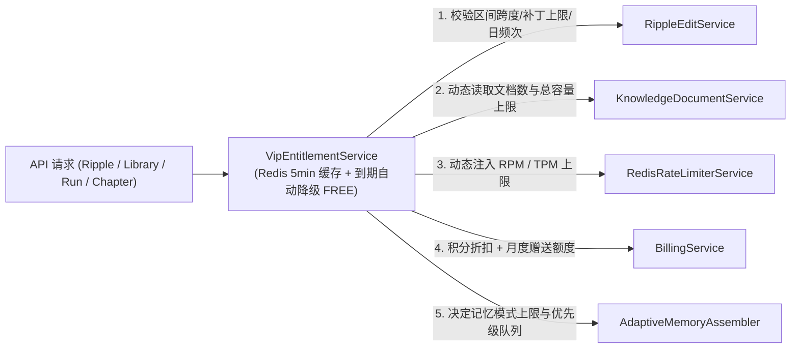

# 05｜VIP 会员分级与动态权益中台设计（VIP & Entitlements）

> 对应子阶段：**Phase 5.5 已合并先行落地（`V8__phase55_vip_entitlements.sql`），Phase 5.8A~D 直接原生接入**
> 核心定位：将原本写死在代码里的配额阈值（个人资料库容量、网关 RPM/TPM、结算折扣、蝴蝶效应最大可选章节跨度、单次补丁章数、万章记忆档位）统一收口到 **可配置的 VIP 会员权益中台**，同时兼顾 **SaaS 商业化变现** 与 **大模型算力成本防线**。

---

## 一、四档会员权益矩阵（商业分层 + 算力背压）

| 权益维度 | `FREE`（免费版） | `VIP`（进阶作者） | `SVIP`（长篇大神） | `STUDIO`（工作室/万章版） |
| :--- | :--- | :--- | :--- | :--- |
| **蝴蝶效应：单次可选最大章节范围** | **≤ 50 章**（前后任选） | **≤ 300 章**（如前后各 150 章 / 整卷） | **≤ 1,000 章**（如前 500 + 后 500） | **≤ 2,000 章 / 全书摘要路由扫描** |
| **蝴蝶效应：粗筛进入精判的候选上限** | Top 20 节 | Top 50 节 | Top 100 节 | Top 150 节 |
| **蝴蝶效应：单次生成局部补丁上限** | **≤ 5 章** | **≤ 20 章** | **≤ 50 章** | **≤ 100 章**（超出强制分批） |
| **蝴蝶效应：每日扫描次数** | 3 次 / 天 | 20 次 / 天 | 60 次 / 天 | 不限（受 TPM 约束） |
| **长篇记忆最高支持规模** | ≤ 100 章（基础摘要） | ≤ 1,000 章（3 级摘要树 + 伏笔导演） | **≤ 10,000 章**（4 级对数树 + Coarse-to-Fine + 休眠唤醒） | **10,000+ 章** + 独立优先队列 |
| **单章/单节字数上限** | 2 万字 | 5 万字 | **10 万字/节（20 万字/章）** | **10 万字/节（20 万字/章）** |
| **伏笔导演台 & 题材档案包** | 6 大主类基础版（≤ 20 条伏笔） | 完整 6 大主类 + 无限伏笔 + 文风锚点（1 段） | 完整功能 + 3 段黄金文风锚点 + POV 隔离 + 时间旅行快照 | 完整功能 + 自定义题材扩展 |
| **个人资料库（USER Scope）** | 5 份 / 10 MB | 30 份 / 60 MB | 100 份 / 300 MB | 500 份 / 2 GB |
| **AI 网关限流（RPM / TPM）** | 10 / 40k | 30 / 150k | 60 / 400k | 120 / 1,000k |
| **每月赠送额度（Credits）** | 20 Credits | 200 Credits | 600 Credits + 9 折积分消耗 | 2,000 Credits + 8 折积分消耗 |
| **推理审稿（`critic-reasoner`）** | 每日 3 次 | 不限 | 不限 + 高优通道 | 不限 + 专属并发舱壁 |

> **为什么“最多可选章数”推荐最高给到 2,000 章（以及 STUDIO 的全书摘要粗筛）？**
> - **技术上限**：PG 索引 + Milvus 标量区间过滤在万章规模下仅需 < 0.5s，真正消耗 Token 的是 Stage 2b「粗筛后送入快模型精判的疑似候选章数（Top $K$）」。通过 **VIP 绑定 `max_candidates_cap`（20 / 50 / 100 / 150）**，即使 STUDIO 用户框选全书 5,000 章扫描，单次扫描成本也严格封顶在 **¥0.5 ~ ¥0.7**，绝无成本失控风险！
> - **交互上限**：单次补丁生成上限卡在 **50 ~ 100 章** 是因为人类作者一次逐章审阅 Git Diff 的精力极限就是几十章；超出时系统支持「分批勾选生成补丁（Batch 1 → Batch 2）」，既不剥夺修改权，又保证体验可控。

---

## 二、数据库表结构设计（并入 Flyway `V8`）

```sql
-- 1. VIP 套餐与权益配置表（支持后台热更新配额，不改代码！）
CREATE TABLE vip_plans (
    plan_code              VARCHAR(24)  PRIMARY KEY, -- FREE / VIP / SVIP / STUDIO
    display_name           VARCHAR(64)  NOT NULL,
    monthly_price_cents    INT          NOT NULL DEFAULT 0,
    monthly_grant_micros   BIGINT       NOT NULL DEFAULT 20000000,
    credit_discount_bps    INT          NOT NULL DEFAULT 10000, -- 10000=原价, 9000=9折, 8000=8折
    entitlements_json      JSONB        NOT NULL,
    /* entitlements_json 示例:
       {
         "rippleMaxRangeChapters": 1000,
         "rippleAllowFullBook": false,
         "rippleMaxCandidates": 100,
         "rippleMaxPatchChapters": 50,
         "rippleDailyScanLimit": 60,
         "maxMemoryChapters": 10000,
         "maxSectionChars": 100000,
         "maxStyleAnchors": 3,
         "userLibraryMaxDocs": 100,
         "userLibraryMaxTotalBytes": 314572800,
         "rpmLimit": 60,
         "tpmLimit": 400000,
         "priorityQueue": true
       }
    */
    enabled                BOOLEAN      NOT NULL DEFAULT TRUE,
    sort_order             INT          NOT NULL DEFAULT 0,
    updated_at             TIMESTAMPTZ  NOT NULL DEFAULT NOW()
);

-- 2. 用户会员订阅状态表（单用户当前生效订阅 + 到期自动降级 FREE）
CREATE TABLE user_subscriptions (
    id                  UUID         PRIMARY KEY DEFAULT gen_random_uuid(),
    user_id             UUID         NOT NULL UNIQUE REFERENCES users(id) ON DELETE CASCADE,
    plan_code           VARCHAR(24)  NOT NULL REFERENCES vip_plans(plan_code),
    status              VARCHAR(24)  NOT NULL DEFAULT 'ACTIVE', -- ACTIVE / EXPIRED / CANCELLED
    started_at          TIMESTAMPTZ  NOT NULL DEFAULT NOW(),
    expires_at          TIMESTAMPTZ,                             -- NULL 表示永久（如 FREE）
    auto_renew          BOOLEAN      NOT NULL DEFAULT FALSE,
    last_order_id       VARCHAR(128),
    version             BIGINT       NOT NULL DEFAULT 0,
    created_at          TIMESTAMPTZ  NOT NULL DEFAULT NOW(),
    updated_at          TIMESTAMPTZ  NOT NULL DEFAULT NOW()
);

CREATE INDEX idx_user_subs_expires ON user_subscriptions (status, expires_at)
    WHERE expires_at IS NOT NULL;

-- 3. 会员订单/开通流水表（幂等对账，支持模拟支付/后台手动授予/接入真实支付网关）
CREATE TABLE vip_orders (
    id                  UUID         PRIMARY KEY DEFAULT gen_random_uuid(),
    user_id             UUID         NOT NULL REFERENCES users(id) ON DELETE CASCADE,
    plan_code           VARCHAR(24)  NOT NULL REFERENCES vip_plans(plan_code),
    duration_days       INT          NOT NULL DEFAULT 30,
    amount_cents        INT          NOT NULL DEFAULT 0,
    payment_channel     VARCHAR(32)  NOT NULL DEFAULT 'CREDITS', -- CREDITS / ADMIN_GRANT / ALIPAY / WECHAT / STRIPE
    idempotency_key     VARCHAR(128) NOT NULL UNIQUE,
    status              VARCHAR(24)  NOT NULL DEFAULT 'PAID',    -- PENDING / PAID / REFUNDED
    created_at          TIMESTAMPTZ  NOT NULL DEFAULT NOW()
);
```

---

## 三、全链路架构集成（零侵入现有服务）



1. **统一权益解析器 `VipEntitlementService`**：
   - 查询 `user_subscriptions`（带 Redis `foliarc:vip:user:{userId}` 5 分钟短缓存，续费/升级/后台改配额时主动 `DEL` 失效）；
   - 若无订阅记录或 `expires_at < NOW()`，自动无感降级为 `FREE` 套餐（不依赖定时任务扫表，强一致防过期白嫖）。
2. **明确区分“权限超限错误码”与“余额不足错误码”**：
   - 当用户框选的蝴蝶效应区间超过当前 VIP 档位上限（例如 `FREE` 用户选了 180 章），后端返回标准错误码 **`403 VIP_QUOTA_EXCEEDED`**，并附带结构化元数据：
     ```json
     {
       "code": "VIP_QUOTA_EXCEEDED",
       "message": "当前方案（免费版）单次蝴蝶效应最多扫描 50 章，您选择了 180 章",
       "feature": "RIPPLE_RANGE",
       "currentLimit": 50,
       "requested": 180,
       "recommendedPlan": "VIP",
       "recommendedLimit": 300
     }
     ```
   - 前端拦截该错误码直接弹出**「调整范围至 50 章 / 一键升级 VIP（解锁 300 章）」**卡片，体验丝滑不生硬。
3. **与既有计费账本（`BillingService`）无缝联动**：
   - 开通/续费会员支持「账户积分兑换（本地演示与压测零依赖）」和「独立运营后台（`apps/admin` + `admin-java`）管理员授予」两种开箱即用通道，同时预留 `PaymentProvider` 接口供后续对接微信/支付宝/Stripe；
   - `BillingService.settleRun` 结算时读取用户 `credit_discount_bps`（如 SVIP 9 折），并按月自动发放 `monthly_grant_micros` 赠送积分。

---

## 四、REST API 清单

| 方法与路径 | 所属服务 | 说明 |
| :--- | :--- | :--- |
| `GET /api/v1/vip/plans` | `biz-java (:8080)` | 获取公开的 4 档会员方案与完整权益对比矩阵 |
| `GET /api/v1/vip/me` | `biz-java (:8080)` | 获取当前登录用户的会员等级、到期时间、今日蝴蝶效应剩余次数与全部动态配额 |
| `POST /api/v1/vip/subscribe` | `biz-java (:8080)` | 开通/升级/续费会员（支持 `idempotencyKey` 幂等防重扣） |
| `POST /api/v1/admin/vip/grant` | `admin-java (:8081)` | 独立运营后台 `ROLE_ADMIN` 手动给指定用户授予/调整会员套餐并记录操作审计（详见 [06-ADMIN-SYSTEM-SEPARATION.md](./06-ADMIN-SYSTEM-SEPARATION.md)） |
| `PUT /api/v1/admin/vip/plans/{planCode}` | `admin-java (:8081)` | 独立运营后台 `ROLE_ADMIN` 动态调整套餐权益阈值并立即刷新共享 Redis 缓存 |
