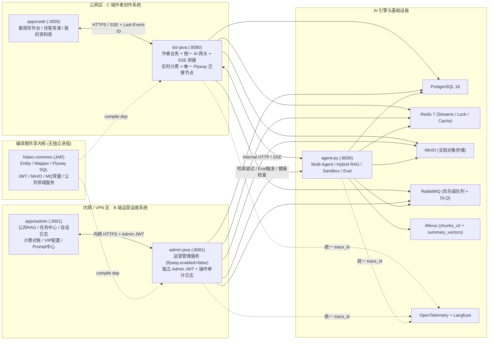

# 06｜运营后台独立拆分与 Java 多模块共享内核架构设计（Admin Separation）

> 对应实施阶段：**Phase 6（独立运营后台 `apps/admin` + `admin-java` 与全链路可观测/评测体系）**
> 核心定位：将 **C 端作者创作系统** 与 **B 端运营运维后台** 在前端应用、Java 运行时进程、安全鉴权边界与部署网络四个层面彻底解耦；同时通过 **Java Maven 多模块共享内核（`foliarc-common`）** 保持数据模型与领域规则的单一真相源，彻底杜绝双工程复制粘贴与 Schema 漂移。

---

## 一、架构决策：为什么要前后端双拆，而非在单体中挂 `/admin` 路由？

| 维度 | 原方案（同前端 `/admin` + 同 `biz-java`） | 新方案（`apps/admin` + `admin-java` 独立拆分） | 收益说明 |
| :--- | :--- | :--- | :--- |
| **故障隔离（Blast Radius）** | 后台查百万行日志、导出计费对账、扫描死信或传大体积公共 PDF 时，直接抢占作者端线程池与数据库连接池 | `admin-java` 拥有独立 JVM 进程与独立 HikariCP 连接池 | 后台慢 SQL 或内存抖动**绝不拖垮**作者端 `:8080` 的高并发网关与 SSE 流式写作 |
| **发布与长连接保护** | 调整运营统计、Prompt 管理或后台权限需重启 `biz-java`，强制掐断所有在线作者的 SSE 流式生成 | `admin-java` 与 `apps/admin` 独立构建发版 | 运营侧高频迭代零感知，不打断作者端长耗时写作任务 |
| **安全与攻击面隔离** | 作者端公网域名与 `biz-java` 同时暴露 `/api/v1/admin/**`，高度依赖路由鉴权无疏漏 | `biz-java` 物理不包含任何管理写接口；`apps/admin` + `admin-java` 仅绑定内网 / VPN / IP 白名单 | 纵深防御（Defense in Depth），从代码打包与网络层消除越权暴露面 |
| **前端包体与心智体验** | 作者端与后台共享构建产物，表格/图表/JSON 查看器等重依赖容易污染作者端 bundle | `apps/web` 极致轻简零工程术语；`apps/admin` 专注高密度数据面板与运维工具 | 前台沉浸式写作体验与后台高信息密度运维体验两不误 |
| **弹性伸缩与成本** | 只能整体扩容 | 作者端按写作高峰横向扩多实例；运营后台单实例低配常驻 | 计算资源按业务负载精准分配 |

---

## 二、目标系统拓扑与 Monorepo 目录结构

### 2.1 双端物理隔离拓扑



### 2.2 演进后的 Monorepo 目录树

```text
foliarc-studio/
├── apps/
│   ├── web/                          # (:3000) C 端作者前台（零后台代码、零工程术语）
│   └── admin/                        # (:3001) B 端独立运营后台（Next.js App Router + TS）
├── services/
│   ├── java/                         # Maven 多模块父工程（统一 Spring Boot 4.1 / JDK 21 / MyBatis-Plus）
│   │   ├── pom.xml                   # <packaging>pom</packaging>，统一 dependencyManagement 与插件配置
│   │   ├── mvnw / .mvn/              # 共享 Maven Wrapper 与 settings.xml
│   │   ├── foliarc-common/           # <packaging>jar</packaging>（不打包 Spring Boot fat jar）
│   │   │   └── src/main/
│   │   │       ├── java/studio/foliarc/common/...
│   │   │       └── resources/db/migration/V1..V9__*.sql   # 单一 Schema 迁移源
│   │   ├── biz-java/                 # (:8080) C 端作者业务 + AI 统一网关 + SSE 桥接 + 实时计费
│   │   └── admin-java/               # (:8081) B 端运营管理服务（RAG授权/任务重试/日志审计/VIP/Prompt）
│   └── agent-py/                     # (:8000) Python 3.12 FastAPI Agent & RAG 引擎
├── contracts/                        # 跨服务事件与 API 契约（SSE / Admin Trace / Eval）
├── evals/                            # 黄金评测集与评测脚本
├── infra/
│   └── docker-compose.yml            # core / rag / app / admin / obs 分层 profiles
└── docs/architecture/                # 00 ~ 06 全套架构设计文档
```

---

## 三、Java Maven 多模块共享内核设计（防复制粘贴、防 Schema 漂移）

直接新建两个毫无关联的 Spring Boot 工程会导致 Entity、Mapper、MinIO、RabbitMQ 契约和 Flyway SQL 双份维护。因此 Java 侧必须采用 **“编译期共享内核 + 运行期独立进程”** 的 Maven 多模块模式：

### 3.1 三模块职责边界清单

| 模块 | 打包产物 | 运行端口 | 包含内容（放什么） | 明确排除（绝不放什么） |
| :--- | :--- | :--- | :--- | :--- |
| **`foliarc-common`** | 普通 Library JAR | 无（库） | • 全部 POJO Entity 与 MyBatis-Plus Mapper<br>• Flyway SQL 迁移文件（`V1` ~ `V9` 单一真相源）<br>• 统一 `ApiException` / `ErrorCode` / 通用分页 DTO<br>• JWT 令牌解析与签名工具、内部服务签名头工具<br>• MinIO 对象存储客户端、RabbitMQ Exchange/Queue/RK 常量、Outbox 写入服务<br>• 跨端复用的无状态领域服务（如 `KnowledgeDocumentService`、`VipEntitlementService`、`OutboxEventService`） | • 任何 `@RestController`<br>• 任何 `SecurityFilterChain`<br>• SSE 长连接桥接与网关限流器<br>• 启动类 `@SpringBootApplication` |
| **`biz-java`** | 可执行 Boot JAR | `:8080` | • C 端作者 API（认证、书架、卷/章/小节、故事宪章、伏笔导演、个人资料库、蝴蝶效应、会员自助订阅）<br>• 统一 AI 网关（Redis+Lua RPM/TPM 限流、Resilience4j 熔断/舱壁）<br>• `RedisStreamSseBridge` 断点续连代理<br>• 实时计费预冻结/结算账本<br>• Python 回调的 `/internal/**` 内部接口<br>• **开启 Flyway 自动迁移（`spring.flyway.enabled=true`）** | • 任何 `/api/v1/admin/**` 控制器与管理员写接口<br>• 重聚合后台报表 SQL |
| **`admin-java`** | 可执行 Boot JAR | `:8081` | • B 端运营 API（`/api/v1/admin/**` 全量端点）<br>• 独立管理员登录与 RBAC 鉴权过滤链<br>• 后台操作审计拦截器（写 `admin_audit_logs`）<br>• 异步任务聚合查询与 DLQ 死信重投服务<br>• Agent 会话轨迹查询、计费对账统计、Prompt 模板版本管理、VIP 套餐热更新<br>• 代理调用 `agent-py` 的混合检索调试与 Eval 触发接口<br>• **显式关闭 Flyway（`spring.flyway.enabled=false`）** | • C 端 SSE 写作流接口<br>• C 端高频写章/自动保存接口 |

### 3.2 关键一致性不变量（Multi-Process Invariants）

1. **Flyway 单点迁移原则**：仅 `biz-java` 在启动时执行 Flyway 迁移，`admin-java` 固定设置 `spring.flyway.enabled=false`（仅依赖 `foliarc-common` 里的编译期 Entity 保持 Schema 对齐），彻底杜绝双进程并发启动争抢 `flyway_schema_history` 锁或误刷旧脚本。
2. **跨进程缓存强一致（Redis 精准失效）**：`admin-java` 修改热点配置后，直接复用 `foliarc-common` 中定义的统一 Redis Key 常量主动 `DEL` 缓存，使 `biz-java` 秒级生效：
   - 后台调整 VIP 套餐配额或手动授予会员 → 立即 `DEL foliarc:vip:user:{userId}` / `foliarc:vip:plans`。
   - 后台更新 `prompt_templates` 生效版本 → 立即更新版本号或失效 Prompt 缓存。
   - 后台上传/授权/停用公共或定向知识库文档 → 通过事务性 Outbox 写入 `outbox_events`，由统一中继推入 RabbitMQ 触发 `agent-py` 向量化，并自动对相关作者可见。
3. **数据库连接池隔离**：`biz-java` 分配主连接池配额（如 `maximum-pool-size: 20`），`admin-java` 限制小连接池（如 `maximum-pool-size: 6`）并开启语句超时（`statement_timeout=10s`），确保运维复杂查询不会打满 PostgreSQL 连接数。

---

## 四、安全认证、操作审计与网络隔离策略

1. **双端 Token 严格隔离（防普通作者 Token 撞库后台）**：
   - `admin-java` 的登录接口（`POST /api/v1/admin/auth/login`）校验用户角色必须包含 `ROLE_ADMIN`，签发独立 Audience 声明 **`aud = "foliarc-admin"`**（并支持配置独立签名密钥 `ADMIN_JWT_SECRET`，默认回退独立派生密钥），Access Token 有效期缩短（如 2 小时）。
   - `admin-java` 的 `SecurityFilterChain` 强制校验 `aud == "foliarc-admin"` 且具备 `ROLE_ADMIN`；普通作者在 `apps/web` 获取的 `aud = "foliarc-web"` Token 即使被传入 `:8081` 也会直接被拒绝（`401/403`）。
   - `biz-java` 彻底移除 `/api/v1/admin/**` 路由与原有 `AdminKnowledgeController`，从代码层面杜绝公网入口暴露后台能力。
2. **后台全量操作审计日志（`admin_audit_logs`，规划入 Phase 6 迁移 `V9`）**：
   ```sql
   CREATE TABLE admin_audit_logs (
       id            UUID         PRIMARY KEY DEFAULT gen_random_uuid(),
       operator_id   UUID         NOT NULL REFERENCES users(id),
       operator_name VARCHAR(64)  NOT NULL,
       action        VARCHAR(64)  NOT NULL, -- KNOWLEDGE_GRANT / JOB_RETRY / VIP_GRANT / PROMPT_PUBLISH ...
       target_type   VARCHAR(32)  NOT NULL, -- DOCUMENT / OUTBOX_EVENT / USER / VIP_PLAN / PROMPT
       target_id     VARCHAR(128) NOT NULL,
       before_json   JSONB,
       after_json    JSONB,
       client_ip     VARCHAR(64),
       trace_id      VARCHAR(64),
       created_at    TIMESTAMPTZ  NOT NULL DEFAULT NOW()
   );
   CREATE INDEX idx_admin_audit_created ON admin_audit_logs (created_at DESC);
   CREATE INDEX idx_admin_audit_target  ON admin_audit_logs (target_type, target_id);
   ```
   - 所有后台写操作（上传/删除公共资料、授权、重投任务、改 VIP 套餐、发版 Prompt）通过 Spring AOP `@AdminAudited` 自动落盘前后快照与 `trace_id`，做到“谁在何时改了什么”100% 可回溯。
3. **部署网络边界**：
   - 生产反向代理（Nginx / Envoy）仅将 `apps/web` 与 `biz-java` 映射到公网域名；`apps/admin` 与 `admin-java` 绑定内网域名或内网 Ingress + IP 白名单 / VPN。

---

## 五、运营后台五大核心模块与 API 归属（`admin-java :8081` + `apps/admin :3001`）

| 运营模块 | 前端路由（`apps/admin`） | 后端 API 前缀（`admin-java :8081`） | 核心功能与数据来源 |
| :--- | :--- | :--- | :--- |
| **1. 公共 / 定向 RAG 资料库** | `/knowledge` | `/api/v1/admin/knowledge/**` | 迁入 Phase 5.5 已建的公共/定向文档上传、题材标签（`genre_codes`）配置、`knowledge_grants` 零拷贝定向授权、切片原文查看，并新增多 Scope 混合检索调试台（调 `agent-py` 展示 `BOOK/USER/ASSIGNED/GLOBAL` 召回权重与得分） |
| **2. 异步任务与死信中心** | `/jobs` | `/api/v1/admin/jobs/**` | 聚合监控 `outbox_events`、文档解析（`PARSING/CHUNKING/EMBEDDING/FAILED`）、章节统一编译/摘要归并、蝴蝶效应扫描任务；支持错误堆栈排查、RabbitMQ DLQ 死信一键重投与幂等重跑 |
| **3. Agent 会话日志中心** | `/traces` | `/api/v1/admin/traces/**` | 新增 `agent_run_events` 关键节点持久化表（仅存 `route_decision`、`agent_handoff`、`tool_call`、`tool_result`、命中 RAG 出处与得分、`critic_review`、`interrupt`、`error`、`usage`，不存逐字 `text_delta` 碎片，带脱敏与 TTL 归档）；以时间轴瀑布图串联 `agent_runs`、PG Checkpoints、`guardrail_audit_logs` 与 OTel/Langfuse `trace_id` |
| **4. 计费、VIP 与网关监控** | `/billing`、`/vip` | `/api/v1/admin/billing/**`<br>`/api/v1/admin/vip/**` | 完整收编原 `/billing` 账本流水、模型成本分布、Prompt Cache 省费比例、Redis 限流/熔断指标；承载 [05-VIP-ENTITLEMENTS-SYSTEM.md](./05-VIP-ENTITLEMENTS-SYSTEM.md) 定义的 `POST /api/v1/admin/vip/grant` 与 `PUT /api/v1/admin/vip/plans/{planCode}` 热更新配置 |
| **5. Prompt 注册与操作审计** | `/prompts`、`/audit` | `/api/v1/admin/prompts/**`<br>`/api/v1/admin/audit/**` | `prompt_templates` 在线编辑、版本对比、灰度发布与一键回滚；查看 `admin_audit_logs` 运营操作审计流水 |

---

## 六、开发运维体验与平滑迁移路径

### 6.1 端口与本地启停约定（更新 `Makefile` 与 `docker-compose.yml`）

| 服务 | 端口 | Make 命令 | Docker Compose Profile | 说明 |
| :--- | :--- | :--- | :--- | :--- |
| `apps/web` | `:3000` | `make dev-web` | `app` | 作者前台（日常写作开发必启） |
| `biz-java` | `:8080` | `make dev-java` | `app` | 作者业务与 AI 网关（日常必启） |
| `agent-py` | `:8000` | `make dev-py` | `app` | Agent & RAG 引擎（日常必启） |
| `apps/admin` | `:3001` | `make dev-admin-web` | `admin` | 运营后台前端（按需启停） |
| `admin-java` | `:8081` | `make dev-admin-java` | `admin` | 运营后台后端（按需启停） |

> 日常只开发作者端功能时，仍然只需启动 3 个进程（`web` + `biz-java` + `agent-py`），不增加平时开发负担；开发或演示运营后台时再拉起 `admin` profile。

### 6.2 零破坏平滑拆分实施步骤（Phase 6 启动首步）

1. **Step 1 — Java 多模块重构（纯结构调整，行为零变更）**：
   - 建立 `services/java/pom.xml` 父工程与 `foliarc-common`、`biz-java`、`admin-java` 三个子模块；
   - 将公共 Entity / Mapper / Flyway SQL / MinIO / RabbitMQ / 共享 Service 下沉至 `foliarc-common`；
   - 运行 `./mvnw test` 验证既有全部单元测试（19+ 用例）与打包全绿。
2. **Step 2 — 迁出后台接口与独立安全链**：
   - 将 `AdminKnowledgeController`（及 Phase 5.8D 新增的 `AdminVipController`）从 `biz-java` 迁至 `admin-java`；
   - 在 `biz-java` 的 `SecurityConfig` 中移除 `/api/v1/admin/**`，在 `admin-java` 启用独立 `aud=foliarc-admin` 鉴权链、`flyway.enabled=false` 与 `@AdminAudited` 切面；
   - 清理 `apps/web` 中历史遗留的 `/billing` 页面，收编至 `apps/admin`。
3. **Step 3 — 搭建 `apps/admin` 独立前端骨架与 `V9` 迁移**：
   - 初始化 `apps/admin`（Next.js App Router + Tailwind + 独立环境变量 `NEXT_PUBLIC_ADMIN_API_BASE_URL=http://localhost:8081`）；
   - 新增 `V9__phase6_admin_traces_and_audit.sql`（`agent_run_events`、`admin_audit_logs`）并打通登录鉴权与侧边栏导航。
4. **Step 4 — 逐块落地五大运营模块 + OTel/Langfuse + Eval**：
   - 依次交付：公共/定向 RAG 控制台 → 异步任务与 DLQ 重试中心 → Agent 会话时间轴日志中心 → 计费/VIP/Prompt 管理 → OTel 跨语言链路追踪 + Langfuse + 30+ 场景 Eval 评测。
