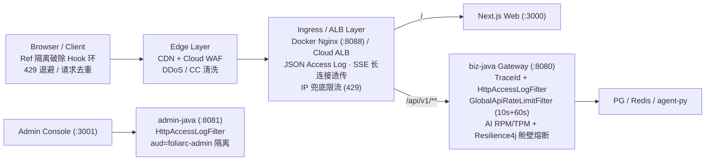

# 入口网关（ALB / Nginx）、全站双窗口限流与 HTTP 可观测性设计

> 对应问题复盘与演进文档：**解决 `/books/[bookId]` 页面死循环请求风暴暴露的三大工程短板**——（1）前端 Hook 依赖环防护；（2）HTTP 请求接入层统一 Access Log 缺失；（3）非 AI 接口缺少全站兜底限流与统一入口网关。

---

## 一、事件复盘（Incident Postmortem）

### 1.1 现象与直接根因
访问 `/books/[bookId]?chapterId=...` 时浏览器在短时间内向 `biz-java` 发送上千条重复请求，导致页面卡顿与后端无效负载。

根因位于 [`apps/web/src/app/books/[bookId]/page.tsx`](../../apps/web/src/app/books/%5BbookId%5D/page.tsx)：
1. `loadChapterDetail` 使用 `useCallback(..., [bookId, tree])` 声明，将状态 `tree` 放入依赖数组；
2. 页面初始化 `useEffect` 依赖 `[authLoading, user, router, bookId, loadChapterDetail]`；
3. 请求返回后调用 `setTree(treeData)` 产生新对象引用 → 触发 `loadChapterDetail` 引用重建 → 再次触发初始化 `useEffect` → 再次请求并 `setTree(treeData)`，形成无限请求闭环。

### 1.2 暴露的两处系统性观测与防护短板
1. **缺少 HTTP 逐条访问日志（Access Log）**：
   - `TraceIdFilter` 仅透传 `X-Trace-Id` 与 MDC，未在请求结束时记录 `METHOD / URI / STATUS / durationMs / userId / clientIp`；
   - `biz-java` 未开启 Tomcat Access Log，导致 `make app-logs` 看不到正常 200 查询请求风暴。
2. **缺少全站通用 API 限流与统一入口反代**：
   - 原有 `RedisRateLimiterService`（RPM / TPM）仅挂接在 `POST /api/v1/runs` AI 推理入口，普通 CRUD 与目录查询接口无全局限流；
   - 本地容器栈由浏览器直连 `web:3000` 与 `biz-java:8080`，缺少 Nginx 入口层做连接控制、IP 突刺兜底与结构化访问日志。

---

## 二、企业级四层纵深防御架构

企业生产系统通常不会仅依赖单层 Nginx，而是按“边缘 → 入口 → 业务网关 → 客户端”构建四层防线：

> [!IMPORTANT]
> **前后台物理隔离红线不变**：遵循 [06-ADMIN-SYSTEM-SEPARATION.md](./06-ADMIN-SYSTEM-SEPARATION.md)，运营后台（`apps/admin :3001` 与 `admin-java :8081`）仅限内网访问，不接入作者端公网入口网关 `gateway :8088`，但共享 `foliarc-common` 的 `TraceIdFilter` 与 `HttpAccessLogFilter`。

---

## 三、企业级可观测性三件套（Logs / Metrics / Traces）

| 支柱 | 采集源 | 本项目落地机制 | 企业生产对接目标 |
| :--- | :--- | :--- | :--- |
| **Logs（日志）** | Nginx 入口 + Java 应用 Filter + Python Uvicorn | Nginx `gateway_json` stdout 日志 + `foliarc-common` `HttpAccessLogFilter`（按 `2xx INFO` / `4xx WARN` / `5xx ERROR` 分级，脱敏不打印 Query String，健康检查降为 `DEBUG`） | Fluent Bit / Promtail → Loki / ELK / 阿里云 SLS，按 `traceId` 秒级聚合检索 |
| **Metrics（指标）** | Spring Boot Actuator + Nginx 状态 | `biz-java` 暴露 `/actuator/metrics`（可扩展 Micrometer + `rate_limit_blocked` 计数） | Prometheus + Grafana 看板，QPS/429/5xx 突增自动告警 |
| **Traces（追踪）** | 全链路请求头透传 | `X-Trace-Id` / W3C `traceparent` 贯穿 `Nginx -> biz-java/admin-java -> agent-py -> agent_run_events` | OpenTelemetry Collector → Jaeger / Tempo / Langfuse |

---

## 四、FoliarcStudio 落地设计与实施清单

### 4.1 已落地的四端改造
1. **前端死循环修复（[`apps/web/src/app/books/[bookId]/page.tsx`](../../apps/web/src/app/books/%5BbookId%5D/page.tsx)）**：
   - 新增 `treeRef` 并通过 `useEffect` 同步最新 `tree`（符合 React 19 ESLint `react-hooks/refs` 规范）；
   - `loadChapterDetail` 改用 `treeSnapshot ?? treeRef.current`，依赖数组收口为 `[bookId]`，彻底打破 `setTree -> loadChapterDetail -> useEffect` 死循环。
2. **全链路 HTTP 访问日志（[`foliarc-common`](../../services/java/foliarc-common/src/main/java/studio/foliarc/biz/common/HttpAccessLogFilter.java)）**：
   - `TraceContext` 补充 `USER_ID_ATTRIBUTE`、`resolveClientIp()`（优先取 `X-Forwarded-For` 首段，其次 `X-Real-IP` / `remoteAddr`）与 `sanitizeForLog()`（防 CRLF 日志注入）；
   - `JwtAuthenticationFilter` 与 `AdminJwtAuthenticationFilter` 鉴权成功后写入 `foliarc.userId` 请求属性；
   - `HttpAccessLogFilter`（`@Order(Ordered.HIGHEST_PRECEDENCE + 10)`）统一输出单行可检索日志：
     `HTTP_ACCESS traceId=... method=... path=... status=... durationMs=... userId=... clientIp=... async=...`。
   - 可通过 `HTTP_ACCESS_LOG_ENABLED=false`（`foliarc.http-log.enabled`）一键关闭。
3. **全站 API 双窗口限流（[`GlobalApiRateLimiter.java`](../../services/java/biz-java/src/main/java/studio/foliarc/biz/gateway/GlobalApiRateLimiter.java) + [`GlobalApiRateLimitFilter.java`](../../services/java/biz-java/src/main/java/studio/foliarc/biz/gateway/GlobalApiRateLimitFilter.java)）**：
   - 在 `SecurityConfig` 中紧跟 `JwtAuthenticationFilter` 之后执行，已登录用户按 `user:<userId>`、未登录请求按 `ip:<clientIp>` 计费限流；
   - 单条 Redis Lua 脚本原子检查两个滑动时间桶：
     - **10 秒突发窗口**（默认 `60 req / 10s`）：1 秒内拦截前端死循环风暴，同时放行进入工作台的并发请求；
     - **60 秒持续窗口**（默认 `240 req / 60s`）：限制高频脚本刷接口。
   - 超限返回标准 HTTP `429` JSON（`API_RATE_LIMIT_BURST` / `API_RATE_LIMIT_RPM`）与 `Retry-After`、`X-RateLimit-Limit`、`X-RateLimit-Remaining` 响应头；自动跳过健康检查、`/internal/v1/**` 与 `OPTIONS` 预检请求；Redis 异常时 fail-open 降级放行。
4. **Nginx 统一入口容器（[`infra/nginx/nginx.conf`](../../infra/nginx/nginx.conf) + [`infra/docker-compose.yml`](../../infra/docker-compose.yml)）**：
   - 新增 `gateway` 容器（`nginx:1.27-alpine`，暴露 `${GATEWAY_PORT:-8088}:80`，纳入 `app` 与 `all` profile）；
   - 按路径分四类策略：
     - `/api/v1/runs/*/stream`：**SSE 专用通道**（`proxy_buffering off`、`proxy_cache off`、`proxy_read_timeout 3600s`、单 IP 并发连接 `limit_conn 10`）；
     - `/api/v1/auth/*`：认证接口严格限流（`30r/m`，`burst=15 nodelay`）；
     - `/api/v1/*`：普通业务 API 兜底限流（`20r/s`，`burst=60 nodelay`）；
     - `/` 与 `/api/health`：转发至 `web:3000`（`30r/s`，`burst=80 nodelay`）。

### 4.2 同源入口模式 vs 直连调试模式
- **直连模式（默认，兼容本地开发）**：`NEXT_PUBLIC_API_BASE_URL=http://localhost:8080`，访问 `http://localhost:3000` 时页面走 `:3000`、API 直连 `:8080`（`biz-java` CORS 已默认放行 `http://localhost:3000,http://localhost:8088`）。
- **同源网关模式（类生产 ALB）**：构建 `web` 时设置 `NEXT_PUBLIC_API_BASE_URL=`（空字符串），浏览器统一访问 **`http://localhost:8088`**，所有页面与 API 请求均由 Nginx 接入并记录全量 JSON Access Log，无跨域预检开销。

### 4.3 本地 Nginx 与生产云端 ALB / Ingress 对照表

| 能力 | 本地 Docker Nginx (`nginx.conf`) | 云端生产等价方案（AWS / 阿里云 ALB / K8s Ingress） |
| :--- | :--- | :--- |
| 统一七层路由 | `location ^~ /api/v1/` / `location /` | ALB Listener Rules（Path-based Routing）或 Ingress `rules` |
| 全量访问日志 | `log_format gateway_json` → stdout | ALB Access Logs → S3 / OSS / SLS |
| Trace 贯穿 | `X-Trace-Id` 透传或生成 `$request_id` | ALB `X-Amzn-Trace-Id` / Envoy `x-request-id` |
| SSE 长连接保活 | `proxy_buffering off` + `proxy_read_timeout 3600s` | ALB 空闲超时调大至 `3600s` + Ingress 关闭 proxy buffering |
| 入口防刷与限流 | `limit_req_zone` + `limit_conn_zone` | 云 WAF Rate-based Rule + Ingress `limit-rps` / APISIX |
